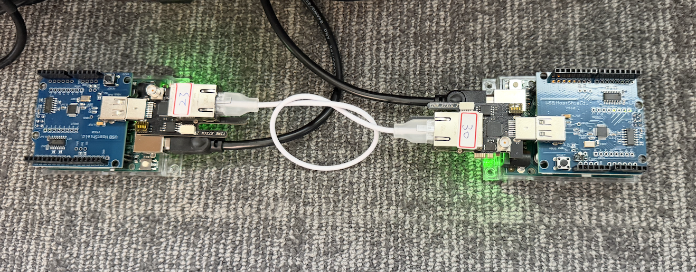
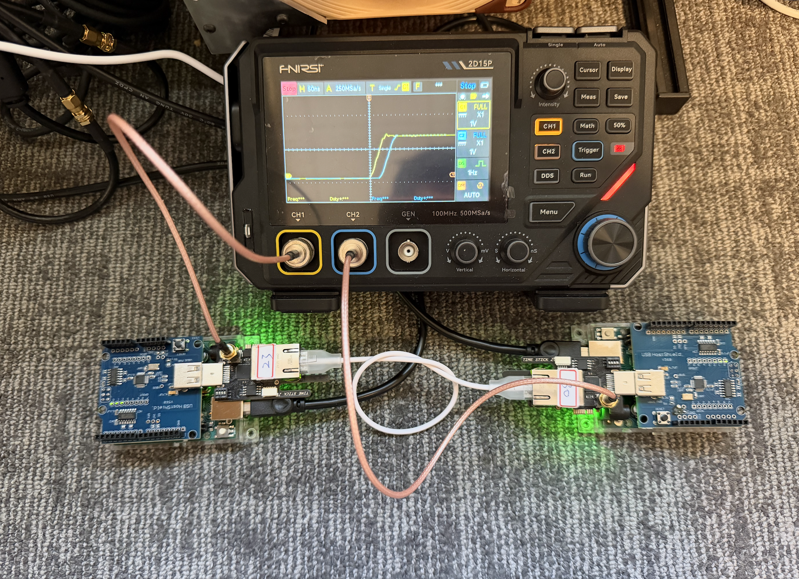
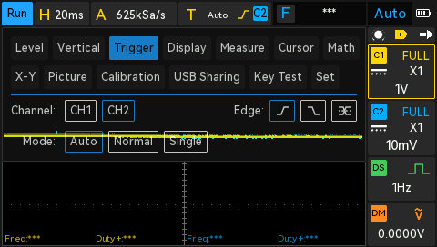
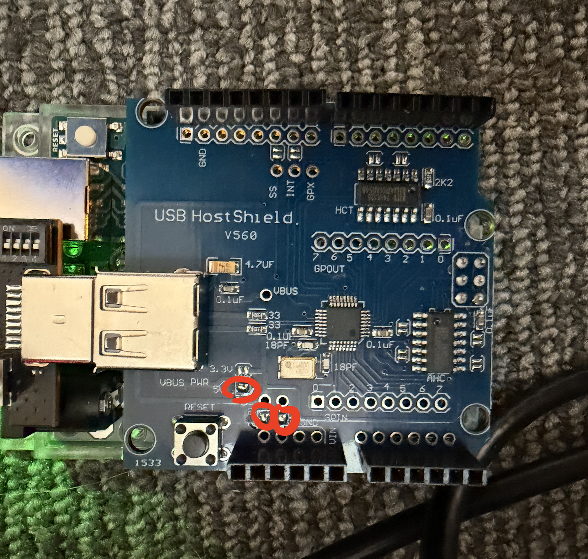

# tinyPTP

Experimental hardware-timestamped PTP on a classic Arduino UNO R3 with a
MAX3421E USB Host Shield and an AX88279-based TimeStick. The UNO runs the PTP
role and follower clock servo; the TimeStick timestamps Ethernet packets and
maintains the hardware clock.

**Working: two UNOs, each with a USB Host Shield and AX88279 TimeStick,
running master/follower PTP over a direct Ethernet cable.**

**Standalone firmware is installed:** the first UNO automatically starts as
grandmaster and the second as follower. Open the follower's serial monitor at
**115200 baud, 8N1** for ptp4l-style offset, frequency, and path-delay output.
The grandmaster also prints ptp4l-style role messages and one-second Sync and
Delay_Resp counters at 115200 baud. No host launcher or startup commands are
needed. See the
[standalone build and serial guide](docs/standalone-roles.md).

The [2026-10-13 pair report](docs/two-uno-test-2026-10-13.md) records both devices,
the 1 Gb/s negotiation fix, and the hardware experiment. Use the
[two-UNO procedure](docs/two-uno-setup.md) for this topology. The earlier
UNO-to-Linux experiment is retained below. This is an experimental fixed-role
implementation, not a complete PTP stack or a flexPTP port.

## The working setup



Each UNO runs its own PTP role through a MAX3421E USB Host Shield. The white
Ethernet cable connects the TimeSticks directly; the USB cables provide UNO
power and serial access. The host computer only captures these serial logs.
Identify roles using the UNO USB serial numbers below, rather than the
handwritten labels or left/right positions in the photographs.

## Live serial output samples

Both ports use **115200 baud, 8N1**, with no flow control. These are actual,
consecutive lines from the paired 100-second capture on **2026-10-13 at
22:44 UTC (15:44 Pacific)**, after startup and servo acquisition.

| Role | UNO USB serial suffix | Port during capture | TimeStick clock identity |
| --- | --- | --- | --- |
| Grandmaster | `E071` | `/dev/ttyACM0` | `9c69d3.fffe.2ba18d` |
| Follower | `C090` | `/dev/ttyACM1` | `9c69d3.fffe.2ba12f` |

### Grandmaster

```text
tinyptp[95.825]: port 1: MASTER sync 84 delay_resp 84 freq +0 timeouts 0 missing_rx 0 discarded 0
tinyptp[96.825]: port 1: MASTER sync 85 delay_resp 85 freq +0 timeouts 0 missing_rx 0 discarded 0
tinyptp[97.825]: port 1: MASTER sync 86 delay_resp 86 freq +0 timeouts 0 missing_rx 0 discarded 0
```

`sync` counts completed hardware-timestamped Sync/Follow_Up pairs; `delay_resp`
counts responses sent to the follower. `freq +0` means the grandmaster uses its
free-running oscillator without an applied frequency correction. Both counts
advance once per second in this sample.

### Follower

```text
tinyptp[95.844]: master offset 45 s3 freq -10698 path delay 735 sample 84 seq 84
tinyptp[96.844]: master offset 45 s3 freq -10700 path delay 735 sample 85 seq 85
tinyptp[97.844]: master offset 35 s3 freq -10696 path delay 735 sample 86 seq 86
```

`master offset` is follower minus grandmaster in **nanoseconds**; `freq` is the
applied correction in **parts per billion**; `path delay` is the estimated mean
one-way delay in **nanoseconds**. `s3` means the last eight accepted offsets were
within +/-1000 ns. These are internal PTP estimates, not oscilloscope readings.
The bracketed time is each UNO's uptime, so it is not a common UTC timestamp.

The run completed **86 follower exchanges with no timeouts**. The grandmaster
printed **87 status lines at 1000 ms intervals**. Read the
[full grandmaster log](docs/results/2026-10-13/master-serial/master-log-20261013-01.log),
[full follower log](docs/results/2026-10-13/master-serial/master-log-follower-20261013-01.log),
and [validation record](docs/results/2026-10-13/master-serial/README.md).
The [serial guide](docs/standalone-roles.md) explains startup, states, and controls.

A later capture attempt at 23:26 UTC encountered a hardware-clock USB access
failure after resetting both UNOs. It produced no PTP samples; see the
[separate diagnostic record](docs/results/2026-10-13/readme-capture/README.md).
A power-cycle retry is pending. The excerpts above remain the earlier verified
run, not output from that failed attempt.


## PPS on the oscilloscope



The supplied photograph shows both PPS rising edges, CH1 in yellow and CH2 in
cyan, on a displayed 50 ns/div horizontal scale. This confirms visible physical
outputs. The photograph was taken separately from the serial capture above;
no cursor measurement, channel-to-role mapping, or cable/channel delay
calibration was supplied, so it is not used to claim a numerical PPS offset.

### Direct USB screenshot export

The scope's saved image was retrieved through USB Sharing on October 13 at
approximately 17:23 Pacific. This particular saved screen has the trigger menu
open and no resolved PPS transitions, so it is a diagnostic capture rather than
a PPS timing measurement.



The [original BMP, companion file, checksums, and export procedure](docs/results/2026-10-13/oscilloscope/README.md)
are preserved. To activate export, press the gray **ON** button inside
**Menu > USB Sharing**, after selecting that tab. The Mac then sees a mass
storage volume. A new saved acquisition showing both PPS edges is still needed
for a direct waveform image of the synchronized outputs.

## USB Host Shield power jumpers



For the pictured **USB Host Shield VS60**, the user marked the **three solder
jumpers that need to be connected** in red: the **5 V VBUS jumper above RESET**
and the **two power jumpers beside the power header**. The photograph shows
the working configuration used for this setup. Make solder changes with power
disconnected and match the pictured board revision and labels; this is not a
universal jumper layout for every USB Host Shield. The unmarked 3.3 V VBUS
selection is not one of the three highlighted connections.

See the [hardware power notes](docs/setup-and-design.md#physical-topology)
and [standalone role guide](docs/standalone-roles.md) for the rest of the setup.

## Two-UNO results, 2026-10-13

The direct pair completed **228 exchanges** in a 240-second run. Over its
last 60 samples, estimated offset RMS was **67.3 ns**, with a range of
**-85 to +150 ns** and mean path delay **735.5 ns**. No exchange timeouts or
rejected path measurements were reported. These are internal PTP estimates,
not independent PPS or UTC measurements.

That earlier interactive image used **25408 bytes flash and 960 bytes static
SRAM**. The newer standalone builds and serial output are documented above. Raw evidence and reproduction details are linked in the pair report.

## Measured results, 2026-10-12

| Test | Result |
| --- | --- |
| MAX3421E and USB | Revision `0x13`, full-speed 12 Mb/s enumeration |
| Ethernet | 1 Gb/s full duplex, 10/10 verified frame round trips |
| Hardware-timestamped PTP | 131 complete exchanges in the principal capture |
| Final 40 samples | Mean -6.375 ns, RMS 13.125 ns, range -29 to +22 ns |
| Mean path delay, same window | 1106.625 ns |
| Exchange timeouts / rejected paths | 0 / 0 |
| Final firmware | 23470 bytes flash, 917 bytes static SRAM |

These offsets are internal PTP estimates after acquisition, not independently
measured PPS or UTC accuracy. Maximum stack use has not been measured.

- [Hardware bring-up history](docs/bringup-2026-10-12.md): power, enumeration,
  original/replacement identification, clock initialization, and Ethernet tests.
- [PTP experiment report](docs/ptp-test-2026-10-12.md): timestamps, acquisition,
  servo results, restart validation, and limitations.
- [Evidence archive](docs/results/2026-10-12/README.md): 30 original diagnostic
  logs, per-sample CSVs, JSON summaries, and checksums.
- [Setup and implementation guide](docs/setup-and-design.md): wiring topology,
  build/upload commands, serial controls, servo behavior, and next steps.

Two units were tested. Both report USB `0B95:1790`, but the original is
**AX88279A** (`bcdDevice 0500`, chip code 15) and is not supported by the current
driver. The replacement is **AX88279 revision 1**, firmware `1.3.16.7`,
MAC `9C:69:D3:2B:A1:2F` (`bcdDevice 0400`, chip code 7); this is the working unit.
The requested target was TimeStick v2, but the replacement's exact PCB revision
is unconfirmed. VID/PID and USB device revision alone do not identify the PCB.

## Running against the Linux PTPBox master

On PTPBox, start the dedicated, time-limited master in one terminal:

```sh
sudo /home/user/tinyPTP/tools/run_ptp_master.sh 180
```

Then run the UNO client in another terminal, using a fresh log filename:

```sh
python3 /home/user/tinyPTP/tools/capture_serial.py \
  /dev/ttyACM0 /home/user/tinyPTP/test-results/ptp-new.log \
  --reset --command es --seconds 160 --end-command x
```

`e` initializes Ethernet; `s` starts the fixed-peer servo. Use `ep` instead to
observe exchanges without disciplining the clock. `x` stops the client and
restores nominal clock frequency. Opening serial resets the UNO, so keep
initialization and PTP in the same session.

The test uses L2 PTPv2, domain 42, two-step Sync, E2E delay, and a 1 Hz master.
The master is pinned to clock identity `0c9d92.fffe.c58332`, port 1. The supplied
host configuration uses only `enp179s0f1` and `free_running 1`; the UNO adjusts
the TimeStick. Existing host PTP services and the host system clock are not
reconfigured. This experiment establishes relative synchronization to the NIC,
not independently verified UTC accuracy.

Current limitations: AX88279 only, 1 Gb/s full duplex, one outstanding exchange,
no BMCA or master failover, a bounded 256-byte aggregate buffer, and a 32-bit
seconds epoch ending in 2106. Oversized aggregates are drained and discarded.
No profile compliance, calibrated PHY asymmetry, or PPS accuracy is claimed.
The original stick identifies as AX88279A and needs a different driver path.

## Feasibility

The AX88279-based units demonstrate this architecture with both a Linux
PTP peer and another UNO. The AX88279A variant remains unsupported. ASIX documents USB full-speed support for both
the AX88179B and AX88279. This matches the MAX3421E's 12 Mbit/s host capability.
An Ethernet PHY operating at 100 Mbit/s or faster does not require the USB host
to sustain that rate for a sparse PTP exchange.

The UNO runs the protocol state machine and clock servo. The TimeStick
maintains the precision hardware clock and timestamps Ethernet ingress and
egress. The standalone firmware now enables and checks the PPS output gate;
the user confirmed PPS output on both units. Quantitative waveform and
edge-offset measurements remain pending. USB delivery
latency does not become the packet timestamp error when timestamps are captured at the Ethernet interface. It
still affects update delay, buffering, and the ability to service timestamp
queues before overflow. Never substitute `micros()` or USB completion times for
hardware packet timestamps.

The target is TimeStick v2, with the AX88279 driver path as the starting point:
the TimeStick2 directory contains AX88279 firmware and its manufacturing archive
contains a `06_TIME_STICK_279` bill of materials. The top-level TimeStick README
describes AX88179B and should not be treated as the v2 programming reference.
Firmware, silicon revision, and full-speed descriptors for the tested units
are recorded in the bring-up report. Additional sticks must be identified
individually; VID/PID alone does not distinguish these ASIX revisions.

## Why flexPTP cannot be used unchanged

The inspected flexPTP source has 16 receive and 16 transmit message-pool entries.
Each contains a 128-byte payload. Those payloads alone require 4096 bytes, before
message metadata, protocol state, queues, network buffers, USB state, and stack.
The ATmega328P has only 2048 bytes of SRAM and 32 KB of flash.

flexPTP does support OS-less operation, so an RTOS is not the obstacle. A port
would require reducing message pools and queues, supplying a USB Ethernet
network adapter and hardware-clock port, auditing AVR integer widths and
floating-point behavior, and measuring the complete linked image. Its stock
memory layout is unsuitable; this is not proof that a carefully reduced fork
could never fit. No full flexPTP AVR build has been attempted here.

The working experiment uses a smaller fixed-role implementation in
`examples/TimeStickProbe/PtpClient.h`. A reduced flexPTP port remains an optional
future direction, not a dependency of the current firmware.

## Implemented PTP exchange

- Linux fixed master and UNO fixed client, domain 42, direct cable, unique identities.
- IEEE 1588v2 over Ethernet, EtherType `0x88F7`, multicast `01:1B:19:00:00:00`.
- End-to-end delay measurement, two-step Sync, initially one exchange per second.
- Sync, Follow_Up, Delay_Req and Delay_Resp; Linux emits Announce, with no client BMCA.
- Static allocation, one outstanding exchange, bounded retries and timeouts.
- Integer timestamp calculations and a bounded fixed-point frequency servo.
- Discipline the client TimeStick clock; independent PPS comparison remains future work.

This intentionally limited experiment is not a complete general-purpose
PTP implementation: no BMCA, P2P/gPTP, management, arbitrary TLVs, or profile
interoperability claim in the first version. Raw Ethernet avoids needing IP,
UDP, DHCP, or ARP on the UNO.

For a zero-correction, symmetric-link example, collect master transmit `t1`,
slave receive `t2`, slave transmit `t3`, and master receive `t4`:

```
offset (slave minus master) = ((t2 - t1) - (t4 - t3)) / 2
mean path delay            = ((t2 - t1) + (t4 - t3)) / 2
```

The implementation must apply correction fields, match domain/source identity/
sequence IDs, reject stale or incomplete exchanges, and reset outstanding
samples after clock steps or link loss. Use separate seconds/nanoseconds fields
and bounded signed differences; do not flatten the entire 48-bit seconds field
into signed 64-bit nanoseconds. Absolute UTC needs an external reference; two
free-running sticks alone can establish relative synchronization.

## Remaining work

1. Characterize longer two-UNO runs, repeated startup, and recovery behavior.
2. Add a separate AX88279A register and timestamp path for the original unit.
3. Independently compare the enabled PPS outputs; assess PHY/link asymmetry.
4. Measure runtime stack high-water use, long-duration stability, and recovery
   from dropped packets, cable changes, USB disconnects, and power cycles.
5. Test background traffic and aggregation pressure before broader deployment.

The AX88279 endpoint `0x84` timestamp report is 131 bytes, assembled from
64/64/3-byte USB packets. The current driver has verified this path on the
replacement unit. RX aggregation uses a bounded 256-byte buffer and drains
oversized aggregates. A normal 1536-byte Ethernet buffer would leave too
little room in the UNO's 2048-byte SRAM for USB state, protocol state, and stack.
The final build leaves 1131 bytes beyond static allocation; that is available
space, not a measured runtime stack margin.

If the UNO's own code needs aligned events, additionally bring a suitably
conditioned TimeStick PPS signal into a timer input and map the AVR timer to
that reference. Synchronizing the dongles does not automatically synchronize
the two AVR timers.

## First hardware check

The sketch at `examples/TimeStickProbe/TimeStickProbe.ino` reads USB device and
configuration descriptors at startup. It prints VID/PID, device revision, interface class,
alternate settings, endpoint addresses/types/sizes, and advertised power. It
streams descriptors instead of storing the full configuration tree. It uses
ordinary USB enumeration and descriptor requests by default. Optional serial
command `v` selects the observed ASIX vendor configuration 1, reads chip and MAC
registers and firmware version, and reads three clock samples if chip code 7 is confirmed. Read
lengths and USB status are checked. This does not initialize Ethernet, start or
adjust the precision clock, or write firmware/EEPROM. Configuration 1 remains
selected until reset or reconfiguration. The clock values are diagnostic only.

Command `i` applies volatile PHY and clock initialization, waits for link,
checks PTP register readback, and checks clock progression. Command `e` also
sets up the MAC and USB bulk endpoints for a 1 Gb/s full-duplex link. Command
`t` sends ten experimental EtherType `0x88B5` frames and checks matching echoes
from `tools/link_peer.py` running on the attached Linux NIC. Receive storage is
256 bytes; oversized and multi-frame aggregates are drained and discarded.
This echo command is a limited transport test, not a general Ethernet receive driver.
The PTP path additionally parses bounded multi-frame aggregates and hardware
timestamps. No command programs the TimeStick's flash, EEPROM, or eFuse.

1. Install **USB Host Shield Library 2.0** by the USB Host Shield team in Arduino
   Library Manager. Select **Arduino Uno** with the AVR core.
2. Stack the shield, attach one TimeStick directly, and provide a stable supply
   adequate for the UNO, shield, and dongle. Check the shield's VBUS wiring and
   power rating. A USB connector by itself does not guarantee adequate power.
3. Upload the sketch and open Serial Monitor at **115200 baud**. Reset the UNO
   if the initial output was missed.
4. Save the entire output for both sticks along with their PCB revision/chip
   markings and shield model. Send `r` to repeat descriptor reads. Send `v` for
   the optional vendor configuration and control-read test.

The probe assumes the library's standard MAX3421E SPI wiring and a directly
connected device. No USB hub driver is instantiated. D4 is held high to deselect
the SD socket on common shields. `USB_STATE_RUNNING` in this probe only means
the generic host enumeration path finished, not that an Ethernet interface is
configured. Descriptor success and clock reads do not prove packet timestamp
delivery or a running, disciplined clock.

Optional CLI build after installing the AVR core and library:

```
arduino-cli compile --fqbn arduino:avr:uno examples/TimeStickProbe
```

Build verification on 2026-10-08: Arduino AVR core 1.8.8, USB Host Shield Library
2.0 version 1.7.0 at the revision below, and QMK's native macOS ARM64 AVR GCC
15.2.0 toolchain produced a linked UNO image using **7934 bytes of flash and
332 bytes of static SRAM**. The installed Arduino GCC and ctags executables
were Intel-only and could not run on this host, so the check used a temporary
native compiler and locally built Arduino ctags. The Arduino installation was
not modified. Exact sizes may differ with the standard Arduino compiler.
That was the original descriptor-only build. Current hardware results and
standard Arduino compiler sizes are recorded in the PTP test report. Runtime
stack headroom has not yet been measured.

## Source references

Inspected on 2026-10-08:

- [TimeStick](https://github.com/Time-Appliances-Project/TimeStick), revision
  `4c2935a1f723f8ec66fc3a3b4fb6a246b9de7c6e`.
  See `TimeStick2/DRV/ax_ptp.c`, `ax_ptp.h`, `ax_main.c`, and
  `ax88179a_772d.c` for the hardware-clock, timestamp, and USB framing paths.
- [flexPTP](https://github.com/epagris/flexPTP), revision
  `3b33b895b230020bbd281b492b6adb9a253234f0`.
  See `src/flexptp/task_ptp.c` and `ptp_types.h` for message pools and payloads.
- [USB Host Shield Library 2.0](https://github.com/felis/USB_Host_Shield_2.0),
  revision `e5bc9950ba5389b67ad99175c312154af53df71d`.
- [ASIX AX88179B](https://www.asix.com.tw/en/product/USBEthernet/Super-Speed_USB_Ethernet/AX88179B)
  and [AX88279](https://www.asix.com.tw/en/product/USBEthernet/Super-Speed_USB_Ethernet/AX88279)
  product specifications.
- [MAX3421E](https://www.analog.com/en/products/max3421e.html) host specifications.
- [Arduino UNO R3](https://docs.arduino.cc/hardware/uno-rev3/) specifications.

No upstream implementation is vendored here. flexPTP is MIT licensed. The ASIX
driver source contains GPL notices, while the TimeStick repository has a
separate hardware/project license. Preserve the applicable notices and review
the relevant file licenses when incorporating upstream code.
