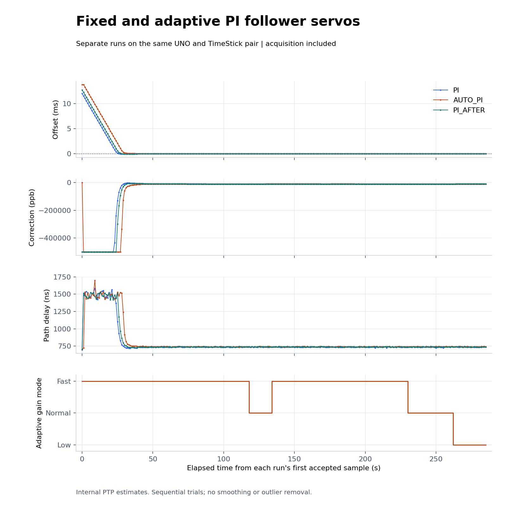
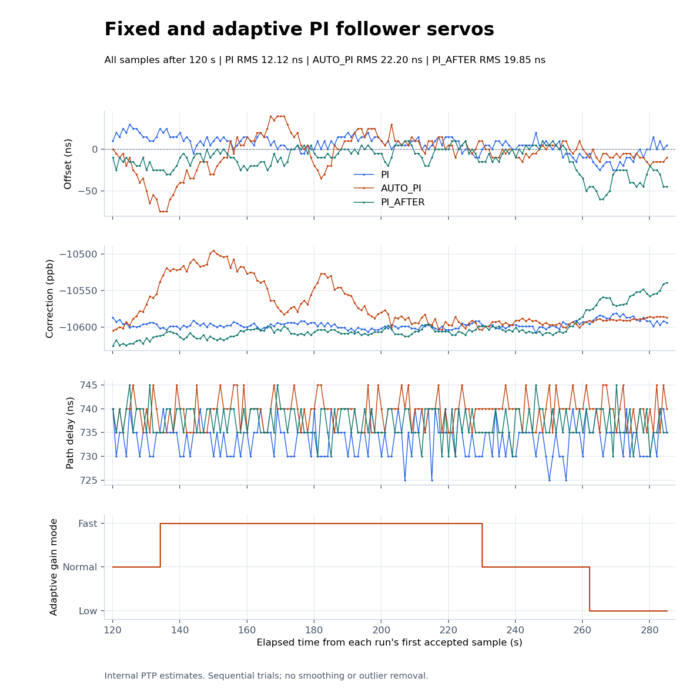

# Adaptive PI hardware trial

The experimental `auto_pi` follower selects bounded proportional and integral
gains from 16-sample windows of offset measurements. It increases bandwidth
for persistent signed offset and reduces it after two qualifying quiet or
frequently alternating windows. It also retains fractional integral correction
and uses actual Sync intervals. See the [servo guide](../../../servos.md) for
exact gains, thresholds, limits, and restart behavior.

The order is fixed PI, adaptive PI, then fixed PI again, each for 300 seconds
on the same UNO/TimeStick pair. The repeated reference was added after
observing a larger change in frequency correction during the adaptive trial. Both boards are reset before each capture;
only the follower firmware changes. The grandmaster is unchanged. The first
120 seconds after the first accepted sample are excluded from the comparison.
All subsequent accepted samples are retained, including non-s3 states.
No smoothing or outlier removal is applied.

These are sequential trials with uncontrolled oscillator temperature and
drift, not proof of optimal tuning. Internal PTP offsets are not independent
PPS or UTC accuracy measurements. The two algorithms also differ in integral
precision and interval handling, so the comparison does not isolate the effect
of gain scheduling alone. The prior linreg experiment is a separate dataset.

## Hardware results

On October 13, Pacific time, captures started at **20:20:04** for PI,
**20:25:48** for adaptive PI, and **20:31:52** for PI again. The corresponding
UTC date is October 14. Each completed 286 exchanges with no sample-number
gaps, no reported exchange errors on either board, and successful PPS enable
readback. There were no failed initializations, coarse clock steps, or rejected
paths. Each fixed-cutoff window contains 166 samples over about 165 seconds,
all in s3.

| Measurement | Fixed PI before | Adaptive PI | Fixed PI after |
| --- | ---: | ---: | ---: |
| Offset RMS | 12.12 ns | 22.20 ns | 19.85 ns |
| Mean offset | +5.57 ns | -4.55 ns | -12.53 ns |
| Offset population standard deviation | 10.76 ns | 21.72 ns | 15.39 ns |
| Offset range | -25 to +30 ns | -75 to +40 ns | -60 to +10 ns |
| Mean path delay | 733.70 ns | 739.49 ns | 737.17 ns |
| Frequency correction range | -10608 to -10581 ppb | -10605 to -10495 ppb | -10626 to -10539 ppb |
| First s3 after first accepted sample | 76.029 s | 62.024 s | 74.030 s |

**Adaptive PI did not improve RMS in this experiment.** It exercised all
three gain levels and remained synchronized, but its offset RMS exceeded both
fixed-PI references. The larger correction excursion during its trial and
variation between the reference runs limit causal conclusions. Different
initial offsets also prevent treating first-s3 times as a controlled comparison.
The implementation remains experimental and does not replace fixed PI as the
default. Further tuning needs repeated trials with controlled disturbances,
not selecting only favorable portions of these captures.





Adaptive gain transitions occurred at follower uptimes 130.878 s (Normal),
146.886 s (Fast), 242.929 s (Normal), and 274.944 s (Low). It started in Fast.
The analyzed window contains 24 samples in Low, 46 in Normal, and 96 in Fast.
The plots use elapsed time after the first accepted sample, not boot uptime.

| Run | Follower log | Grandmaster log | Extracted samples |
| --- | --- | --- | --- |
| PI before | [Log](autopi-baseline-20261013-01-follower.log) | [Log](autopi-baseline-20261013-01-master.log) | [CSV](plots/pi-samples.csv) |
| Adaptive PI | [Log](autopi-adaptive-20261013-01-follower.log) | [Log](autopi-adaptive-20261013-01-master.log) | [CSV](plots/auto_pi-samples.csv) |
| PI after | [Log](autopi-after-20261013-01-follower.log) | [Log](autopi-after-20261013-01-master.log) | [CSV](plots/pi_after-samples.csv) |

[Gain-change CSV](plots/auto-pi-gains.csv) |
[Numerical comparison](plots/comparison.json) |
[Counter and PPS validation](validation.json) |
[Acquisition SVG](plots/servo-acquisition.svg) |
[Steady-state SVG](plots/servo-steady-state.svg)

The follower is left running the tested fixed-PI image. The final reference
capture verifies that restored state. Adaptive PI remains available through
the build selection. `SHA256SUMS` covers this report and its evidence; check
it from this directory with `sha256sum -c SHA256SUMS`.

## Reproduce

From the repository root, with Python 3 and matplotlib:

```sh
python3 tools/compare_servos.py \
  docs/results/2026-10-13/auto-pi/autopi-baseline-20261013-01-follower.log \
  docs/results/2026-10-13/auto-pi/autopi-adaptive-20261013-01-follower.log \
  --candidate-label AUTO_PI --after 120 \
  --reference-after docs/results/2026-10-13/auto-pi/autopi-after-20261013-01-follower.log \
  --output-dir docs/results/2026-10-13/auto-pi/plots
```

The capture command is `tools/capture_serial.py PORT OUTPUT --seconds 300 --reset`
on both ports concurrently, at 115200 baud. No protocol-start or stop command
is sent. Firmware runs the control loop independently of the logger.
The plot uses serial uptime relative to each run's first accepted exchange.
Gain telemetry is carried forward between logged changes; sample statistics
use the original unsmoothed offset messages.

## Implementation and checks

The source default remains fixed PI. Build the experiment with
`SERVO=auto_pi BUILD_DIR="$PWD/build/auto-pi" sh tools/build_roles.sh`.
The adaptive follower uses 30,364 flash bytes and 1,017 static SRAM bytes,
compared with 28,556 and 995 for fixed PI. Runtime stack maximum is unmeasured.
[Firmware and tested source hashes](firmware.json) identify both images.
Rebuilding fixed PI from the new source produced the identical HEX hash used
for the references. The grandmaster firmware was never changed.

Host tests passed with address and undefined-behavior sanitizers. They cover
frequency-error polarity, noisy and drifting closed-loop models, nonuniform
intervals, timestamp wrap, large phase-step recovery, output limits, gain
hysteresis, and holding the command after missing or duplicate timestamps.
Protocol tests pass for fixed PI, linreg, and adaptive PI. The existing math,
PPS, serial-format, and log-summary tests also pass. Both role variants of the
adaptive firmware compile for the UNO; only the follower variant was flashed.

In the deterministic models, true-phase RMS for fixed/adaptive PI was
5.10/2.41 ns with small timestamp noise, 19.42/11.40 ns with a frequency ramp,
and 37.24/26.73 ns with larger timestamp noise. These are simulated results,
not hardware measurements; they are kept separate from the hardware table.
