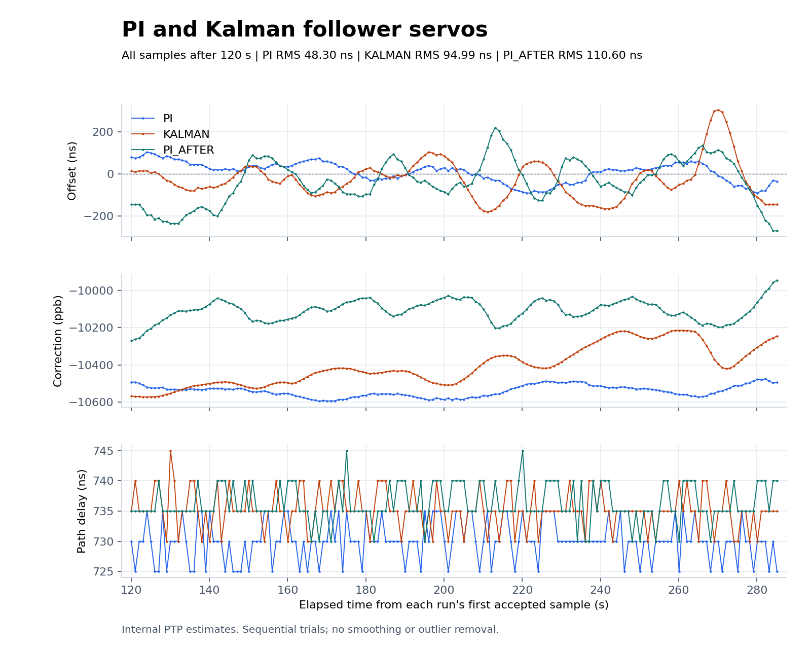
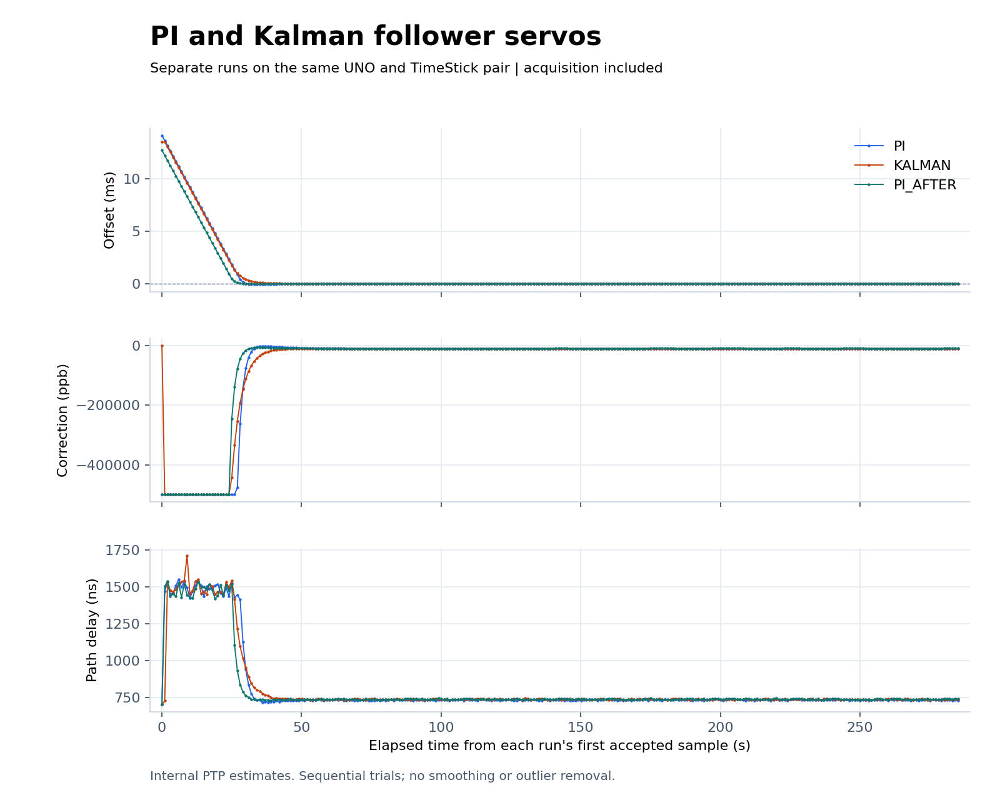

# PI / Kalman / PI hardware experiment

Remote recovery succeeded without physical intervention. Three five-minute
runs then completed on the same two UNO/USB Host Shield/TimeStick assemblies,
using a direct Ethernet connection, fixed roles, and the unchanged grandmaster
image. The follower ran fixed PI, Kalman, then fixed PI again. **PI has been
restored and is the installed follower servo.**

## Measured comparison

Captures began on October 13, 2026 at 21:37:33, 21:43:12, and 21:48:41 Pacific
(October 14 at 04:37:33, 04:43:12, and 04:48:41 UTC). Each serial capture lasted
300 seconds at 115200 baud. Both UNOs were reset at the beginning of each run.
Each follower log contains 286 accepted exchanges. Analysis excludes the
first 120 seconds from each run's first accepted sample, leaving 166 samples
spanning about 165.08 seconds per run. Every accepted sample after that cutoff
is retained, with no smoothing or outlier removal.

| Run | Offset RMS | Offset mean | Offset range | First `s3` after first sample |
| --- | ---: | ---: | ---: | ---: |
| PI before | 48.30 ns | +9.46 ns | -90 to +105 ns | 80.03 s |
| Kalman | 94.99 ns | -25.21 ns | -180 to +305 ns | 59.03 s |
| PI after | 110.60 ns | -35.24 ns | -270 to +220 ns | 73.03 s |





Kalman falls between the two PI references. The difference between the PI
runs is itself large, so this sequential experiment cannot establish a
repeatable Kalman advantage or isolate servo choice from changing conditions.
Frequency corrections also differ between runs; temperature and external
reference timing were not measured. The shorter time to first `s3` is an
observation from these startups, not a controlled acquisition-speed benchmark.

These are raw four-timestamp PTP offset estimates. They are not the Kalman
filter's smoothed state, independently calibrated PPS offsets, or proof of UTC
accuracy. `s3` is the application's servo-state indicator, not independent
measurement of lock quality. All measured-window samples were in `s3`, with
no sample-number gaps. Both roles reported PPS enabled by register readback.
All six logs contain one boot and no initialization failures, link-down events,
timeouts, missing receive timestamps, or discarded exchanges during these trials.

## Evidence and reproduction

| Run | Grandmaster | Follower |
| --- | --- | --- |
| PI before | [Log](kalman-baseline-20261013-02-master.log) | [Log](kalman-baseline-20261013-02-follower.log) |
| Kalman | [Log](servo-kalman-20261013-01-master.log) | [Log](servo-kalman-20261013-01-follower.log) |
| PI after | [Log](kalman-restore-pi-20261013-01-master.log) | [Log](kalman-restore-pi-20261013-01-follower.log) |

- [Summary statistics](plots/comparison.json)
- [PI CSV](plots/pi-samples.csv), [Kalman CSV](plots/kalman-samples.csv), [repeated PI CSV](plots/pi_after-samples.csv)
- [Six-log validation and source hashes](hardware-validation.json)
- [Build sizes and firmware hashes](firmware.json)
- [Model, provisional noise parameters, simulations, and build selection](../../../kalman-servo.md)

From the repository root, regenerate the plots with:

```sh
python3 tools/compare_servos.py \
  docs/results/2026-10-13/kalman/kalman-baseline-20261013-02-follower.log \
  docs/results/2026-10-13/kalman/servo-kalman-20261013-01-follower.log \
  --candidate-label KALMAN --after 120 \
  --reference-after docs/results/2026-10-13/kalman/kalman-restore-pi-20261013-01-follower.log \
  --output-dir docs/results/2026-10-13/kalman/plots
```

## Initial failure and remote recovery

The first baseline attempt began at 21:15:08 Pacific, before Kalman was
uploaded. The grandmaster repeatedly failed initialization. The follower
briefly reported PPS enabled and entered LISTENING, then lost link. No accepted
exchange was recorded, and the readers were stopped after roughly 200 seconds.
This failed attempt is preserved separately and is not included in the plots.

- [Failed grandmaster baseline](failed-baseline/kalman-baseline-20261013-01-master.log)
- [Failed follower baseline](failed-baseline/kalman-baseline-20261013-01-follower.log)
- [Initial failure metadata](validation.json)
- [Remote recovery actions, temporary firmware, and diagnostic logs](remote-recovery/README.md)

The host USB controller reports no power switching. Logical port reconnection,
PHY reset, and the vendor device-reset command were tested remotely. PTP
recovered after this sequence and restoration of the original firmware. No
physical power cycle was performed, and the individual recovery action and
underlying startup fault have not been isolated.

## Checks completed

Host checks passed with address, undefined-behavior, and float-cast-overflow
sanitizers: double-precision matrix-reference agreement, covariance positivity,
known correction input, nonuniform intervals, timestamp wrap, gaps, both signs
of oscillator error, phase-step recovery, and bounded commands. Existing math,
PI/linreg/adaptive-PI, PPS, serial-format, and log-summary tests also pass.
Protocol tests pass for all four servo selections.

Kalman follower and grandmaster-role builds use 31,426 and 31,428 flash bytes,
respectively, and 1,017 static SRAM bytes. Rebuilding fixed PI from the new
source produced exactly the installed PI HEX hash. No role was reflashed during
the initial baseline attempt. Later [remote recovery experiments](remote-recovery/README.md)
used temporary diagnostic images and restored the original grandmaster and
fixed-PI follower images. The compiled Kalman follower was then uploaded for
its trial, followed by restoration of the saved fixed-PI follower image.

Verify archived evidence from this directory with
`sha256sum -c SHA256SUMS`.
