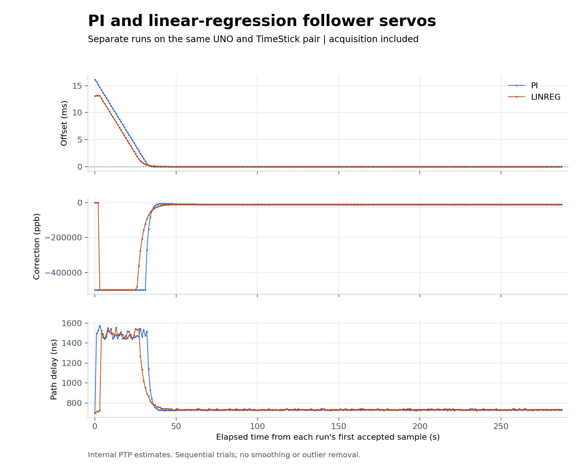
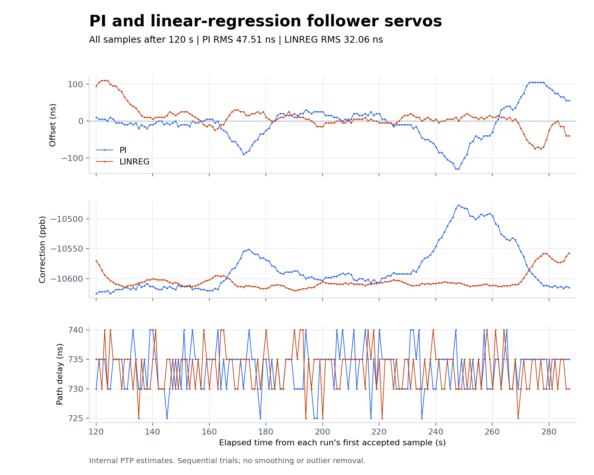

# PI versus fixed-window linear regression

Two consecutive 300-second captures use the same grandmaster, follower,
TimeSticks, and direct Ethernet cable. Both boards are reset at the beginning
of each capture. Only the follower servo selection changes. The first 120
seconds after each run's first accepted exchange are excluded from the
steady-state comparison. Every accepted sample thereafter is retained,
including any non-s3 state; no smoothing or outlier rejection is applied.

These are internal PTP offset estimates, not calibrated physical PPS or UTC
accuracy measurements. Sequential trials do not control temperature or
oscillator drift, and reset timing can change initial offset. A single pair
of runs cannot establish that either controller is generally better.

The [servo guide](../../../servos.md) describes the implementation and build
selection. PI remains the source default. The integer eight-point regression
is independently implemented and is not LinuxPTP's adaptive linreg servo.

## Results

The PI capture began **2026-10-13 20:02:29 Pacific** (October 14 03:02:29 UTC).
The linreg capture began **20:08:15 Pacific** (03:08:15 UTC). Each completed
288 exchanges, with no gaps in sample numbering. Neither board reported
exchange timeouts, missing RX timestamps, or discarded frames. Both startup
sequences reported PPS enabled. There were no coarse clock steps or rejected
paths in either run.

| Measurement | PI | Linreg |
| --- | ---: | ---: |
| Samples after the 120-second cutoff | 168 | 168 |
| Analyzed span | 167.076 s | 167.077 s |
| Offset RMS | 47.51 ns | 32.06 ns |
| Mean offset | -4.49 ns | +8.51 ns |
| Offset population standard deviation | 47.29 ns | 30.91 ns |
| Offset range | -130 to +105 ns | -75 to +110 ns |
| Mean path delay | 733.48 ns | 733.33 ns |
| Correction range | -10625 to -10477 ppb | -10620 to -10557 ppb |
| Samples in s3 after cutoff | 168 / 168 | 168 / 168 |
| First s3, elapsed after first sample | 80.033 s | 60.023 s |

Linreg had lower RMS in this trial pair. Initial offset was approximately
16.16 ms for PI and 13.11 ms for linreg, so their acquisition times are not a
controlled comparison. The changing frequency correction also shows why
longer repeated, alternating trials are needed before choosing a new default.





[PI follower log](servo-pi-20261013-01-follower.log) |
[PI grandmaster log](servo-pi-20261013-01-master.log) |
[Linreg follower log](servo-linreg-20261013-01-follower.log) |
[Linreg grandmaster log](servo-linreg-20261013-01-master.log)

[PI sample CSV](plots/pi-samples.csv) |
[Linreg sample CSV](plots/linreg-samples.csv) |
[Full numerical comparison](plots/comparison.json) |
[Counter and PPS validation](validation.json) |
[Acquisition SVG](plots/servo-acquisition.svg) |
[Steady-state SVG](plots/servo-steady-state.svg)

## Capture and firmware details

The host uses `tools/capture_serial.py` with `--seconds 300 --reset --command q`
on each stable UNO serial path, concurrently. It sends no role-changing command
and no stop command at the end. Firmware runs the protocol without host control.

The diagnostic `q` arrives before hardware initialization completes, so each
log can contain an early `PPS register read failed` line. Successful startup
subsequently reports the PPS gate, clock control, and active pulse width as
enabled. The early query is retained in the raw evidence, not counted as a
failure of the later PTP exchange. Register readback does not measure the
physical output waveform.

[Firmware hashes, build flags, resource use, and board identities](firmware.json)
identify this experiment. The grandmaster firmware is unchanged between trials.
The regression follower consumes 2,618 more flash bytes and 110 more static
SRAM bytes than the PI follower.

## Reproduce the figures

From the repository root, with Python 3 and matplotlib installed:

```sh
python3 tools/compare_servos.py \
  docs/results/2026-10-13/servo-comparison/servo-pi-20261013-01-follower.log \
  docs/results/2026-10-13/servo-comparison/servo-linreg-20261013-01-follower.log \
  --after 120 --output-dir docs/results/2026-10-13/servo-comparison/plots
```

The CSV files contain the full runs. The JSON summary uses the fixed cutoff.
The capture duration is 300 seconds of serial reading after the command delay;
startup and hardware initialization reduce the number of accepted exchanges.

## Final installed state

After the comparison, the tested PI image was restored to the follower.
A separate 120-second paired capture confirmed it restarted automatically,
reached s3, and reported PPS enabled. Neither board reported exchange errors.
The grandmaster remains on its original image. Linreg is available as a build
option, while PI remains the source default and installed follower servo.

[Restored PI follower log](servo-restore-pi-20261013-01-follower.log) |
[Grandmaster during restore verification](servo-restore-pi-20261013-01-master.log)

`SHA256SUMS` covers the raw evidence, generated plots, extracted samples, and
metadata. Verify from this directory with `sha256sum -c SHA256SUMS`.
