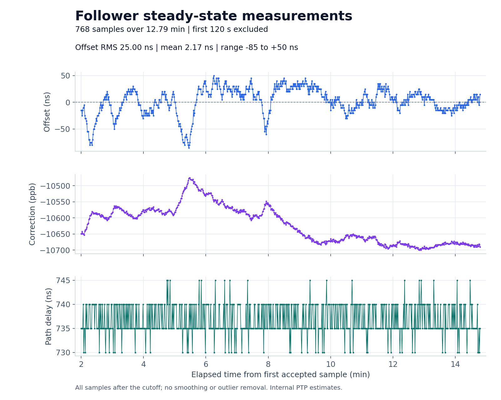

# Longer follower steady-state run

This paired capture began on October 13, 2026 at **17:47:43 Pacific**
(October 14, **00:47:43 UTC**). Both serial collectors requested 900 seconds.
The existing standalone firmware was used without modification. The capture
opened and reset both UNOs, retained both serial sessions, and left the
automatic roles running when collection ended.

The topology was unchanged: two UNO R3 boards, each with a MAX3421E USB Host
Shield and AX88279 TimeStick, joined directly by Ethernet at 1 Gb/s full duplex.
The grandmaster UNO ends in `E071`, clock identity `9c69d3.fffe.2ba18d`; the
follower UNO ends in `C090`, clock identity `9c69d3.fffe.2ba12f`.

## Results

The completed capture contains **888 follower exchanges**, matching the final
grandmaster Sync and Delay_Resp counters. The selected window contains samples
**121 through 888**, spanning **767.350 seconds (12.79 minutes)**.



| Measurement in the fixed analysis window | Result |
| --- | --- |
| Samples | 768 |
| Offset RMS | 25.00 ns |
| Offset mean | +2.17 ns |
| Offset population standard deviation | 24.90 ns |
| Offset range | -85 to +50 ns |
| Mean estimated path delay | 736.72 ns |
| Estimated path-delay range | 730 to 745 ns |
| Frequency correction range | -10700 to -10476 ppb |
| Servo state | `s3` for all 768 samples |
| Largest interval between logged samples | 1.003 s |
| Missing sample numbers | 0 |

Across the full capture, both boards report zero exchange timeouts, missing
receive timestamps, and discarded frames. Each log contains exactly one boot
marker and no initialization failures. The grandmaster emits 889 status lines
at exactly 1000 ms intervals. Both original logs were verified against their
SHA-256 hashes on the hardware host after the collectors finished.

The [paired validation record](validation.json) and
[steady-state summary](plots/steady-state-summary.json) retain the unrounded
statistics. The earlier short capture is documented separately in the
[power-cycle recovery report](../power-cycle-recovery/README.md).

## Analysis window

Before collection, the analysis cutoff was set to **120 seconds after the
first accepted follower exchange**. Every accepted exchange after that cutoff
is retained, regardless of servo state or offset magnitude. There is no
outlier removal, smoothing, or selection of a favorable sub-window. Startup
and the excluded acquisition interval remain in the original log.

The analysis requires exactly one boot marker. Multiple boots invalidate this
single-run analysis instead of silently selecting only the final boot.
Sample counts, timing gaps, servo states, and grandmaster error counters are
checked separately from the offset statistics.

An early `PPS register read failed` line comes from the explicit `q` query
before hardware initialization completed. Both boards subsequently report PPS
enabled during their normal startup. It is not a failed initialization or a
failure during the analysis window.

## Files

- `steady-state-20261013-01-master.log` and `steady-state-20261013-01-follower.log`: original serial captures at 115200 baud, including startup.
- `validation.json`: paired-run counters and completion checks.
- `plots/follower-steady-state.png` and `.svg`: offset, frequency correction, and path delay in the fixed analysis window.
- `plots/steady-state-samples.csv`: all accepted samples in that window, with units in column names.
- `plots/steady-state-summary.json`: window selection, statistics, source hash, state counts, and sample gaps.
- `SHA256SUMS` and `plots/SHA256SUMS`: evidence and figure checksums.

## Reproduce

On the hardware host, run the two collectors together. This resets both UNOs;
do not open another serial monitor during the capture.

```sh
python3 tools/capture_serial.py \
  /dev/serial/by-id/usb-Arduino__www.arduino.cc__0043_1453230343235190E071-if00 \
  steady-state-master.log --seconds 900 --reset --command q &
python3 tools/capture_serial.py \
  /dev/serial/by-id/usb-Arduino__www.arduino.cc__0043_14533303731351B0C090-if00 \
  steady-state-follower.log --seconds 900 --reset --command q &
wait
```

The collectors require Python 3 and pyserial and refuse to overwrite an
existing log. To regenerate the committed graphs from the repository root,
use Python 3 with Matplotlib (3.10.8 was used for these figures):

```sh
python3 tools/plot_steady_state.py \
  docs/results/2026-10-13/steady-state-15min/steady-state-20261013-01-follower.log \
  --output-dir docs/results/2026-10-13/steady-state-15min/plots \
  --after 120
```

All plotted values are **internal PTP estimates**, not independently measured
PPS edge separation or UTC accuracy. This is a single run under the existing
bench conditions, not a temperature sweep or a long-term stability qualification.
