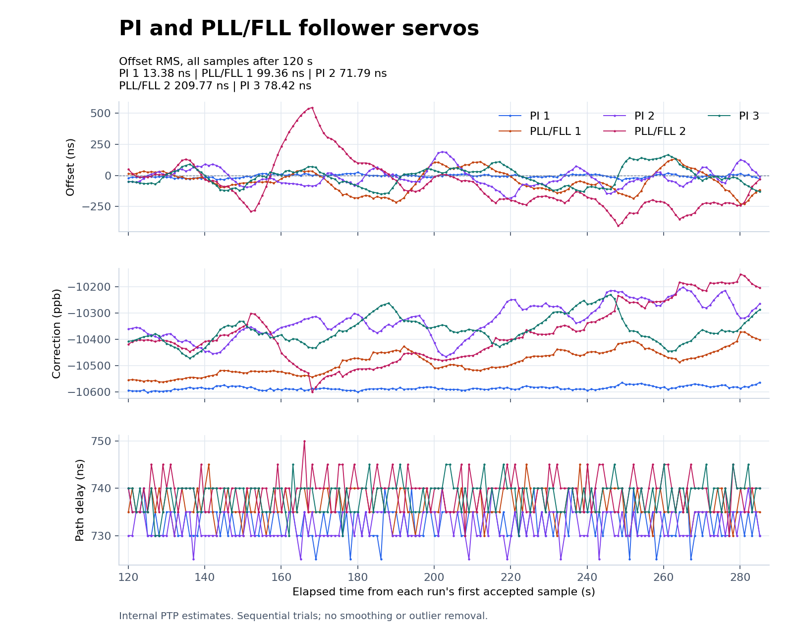
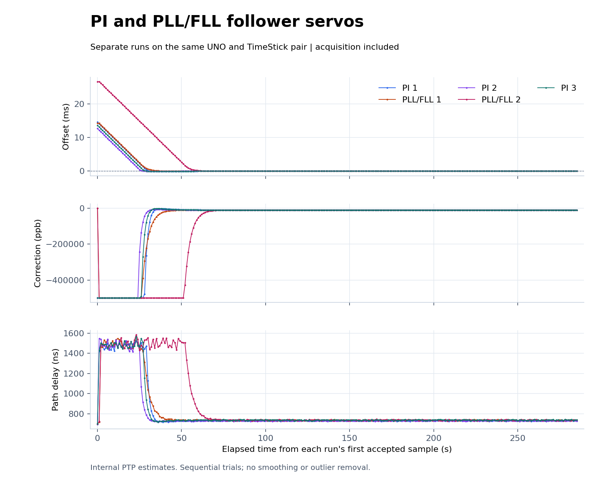

# Repeated PI / PLL/FLL experiment

This experiment evaluates the fixed-point hybrid PLL/FLL follower on the
same two UNO/USB Host Shield/TimeStick assemblies. Five sequential 300-second
captures alternate PI, PLL/FLL, PI, PLL/FLL, PI after a successful 300-second
warm-up. The PLL/FLL parameters are fixed before the experiment: eight
intervals per frequency window, frequency smoothing gain 1/2, four-second
phase correction, and +/-500,000 ppb limits. Both candidate trials use the
same HEX image. The grandmaster image stays unchanged during the comparison.

## Results

All five trials completed on October 14, 2026. Each contains 286 accepted
exchanges; after the 120-second cutoff, each has 166 samples spanning about
165.08 seconds. All 830 measured-window samples are in `s3`. There are no
sample-number gaps, initialization failures, link losses, or reported exchange
errors in the ten trial logs. Both roles report PPS enabled by register readback.
PI is restored and remains the installed/default follower servo.

| Run | Start (Pacific) | Offset RMS | Offset mean | Offset range |
| --- | --- | ---: | ---: | ---: |
| PI 1 | 03:09:44 | 13.38 ns | -4.82 ns | -40 to +25 ns |
| PLL/FLL 1 | 03:14:53 | 99.36 ns | -44.94 ns | -230 to +135 ns |
| PI 2 | 03:20:02 | 71.79 ns | -16.33 ns | -185 to +190 ns |
| PLL/FLL 2 | 03:25:12 | 209.77 ns | -70.57 ns | -405 to +545 ns |
| PI 3 | 03:30:21 | 78.42 ns | -9.94 ns | -150 to +165 ns |





With these parameters, PLL/FLL had higher measured RMS than both adjacent PI
references in each trial. This experiment does not support replacing PI with
this configuration. Its slower frequency estimate has a noise/lag tradeoff
already visible in the synthetic ramp test, but this hardware comparison does
not isolate the cause of each excursion. The PI references also vary greatly,
and these are sequential trials without environmental control.

The first accepted offset in PLL/FLL 2 was about 26.6 ms, roughly twice the
startup offset of PLL/FLL 1. The acquisition plots retain that difference;
we did not move the analysis cutoff or trim excursions to favor a servo.
`s3` denotes the application's state threshold, not independent accuracy
certification.

| Run | Grandmaster log | Follower log | Parsed samples |
| --- | --- | --- | --- |
| PI 1 | [Master](pi-01-master.log) | [Follower](pi-01-follower.log) | [CSV](plots/pi-samples.csv) |
| PLL/FLL 1 | [Master](pllfll-01-master.log) | [Follower](pllfll-01-follower.log) | [CSV](plots/pll_fll-samples.csv) |
| PI 2 | [Master](pi-02-master.log) | [Follower](pi-02-follower.log) | [CSV](plots/pi_middle-samples.csv) |
| PLL/FLL 2 | [Master](pllfll-02-master.log) | [Follower](pllfll-02-follower.log) | [CSV](plots/pll_fll_repeat-samples.csv) |
| PI 3 | [Master](pi-03-master.log) | [Follower](pi-03-follower.log) | [CSV](plots/pi_after-samples.csv) |

[Statistics](plots/comparison.json), [ten-log validation](validation.json),
[completed orchestration status](trial-status.json), and [checksums](SHA256SUMS)
are included. The failed startup and separate warm-up below are not part of
the measured comparison.

## Method

Both serial ports are opened and reset for each trial at 115200 baud. Firmware
initialization and acquisition remain in the raw logs. Analysis uses every
accepted sample at least 120 seconds after that run's first accepted exchange.
There is no smoothing, outlier removal, or selection by servo state. Initial
offsets can differ, so startup time is not a controlled acquisition benchmark.
The warm-up helps provide a consistent procedure but does not establish thermal
equilibrium; no temperature measurement was taken.

The graphs show raw four-timestamp PTP offset, applied frequency correction,
and path delay. They do not show a filtered offset estimate or independently
measured PPS timing. PPS enablement is checked by register readback. The fixed
roles have no UTC reference. Sequential trials on one pair cannot separate all
environmental changes from controller effects or establish universal superiority.

## Startup failure and recovery

The first warm-up attempt began at 03:00:17 Pacific on October 14, 2026
(10:00:17 UTC). Both original images reported four initialization failures and
no accepted PTP exchanges. Those readers were terminated with SIGTERM; the
failed capture is excluded from the comparison.

The temporary interactive device-reset image from the
[previous recovery experiment](../../2026-10-13/kalman/remote-recovery/README.md)
was uploaded to both UNOs. It sent the vendor-driver software-reset request
`0x2a / 0xaa00 / index 0 / data 0x41`. The transfers returned `0x0e`; the
TimeSticks enumerated again, but manual Ethernet initialization still failed.
Restoring the saved original grandmaster and fixed-PI follower images then
restored PTP. No USB-port power switching or physical intervention was used
in this session. The exact startup fault remains unresolved.

A second warm-up began at 03:04:42 Pacific (10:04:42 UTC), completed 286
accepted exchanges, and reported no initialization or exchange errors. It
is archived but excluded from the five-run comparison.

- [Failed warm-up master](warmup-master.log) and [follower](warmup-follower.log)
- [Device-reset master](device-reset-master.log) and [follower](device-reset-follower.log)
- [Successful warm-up master](warmup-02-master.log) and [follower](warmup-02-follower.log)
- [Recovery counts and hashes](recovery.json)

## Reproduction and validation

[The exact lab orchestration script](run_trials.py) records the sequence,
serial identities, startup checks, capture duration, and PI restoration. Its
absolute paths and serial numbers describe this lab, not arbitrary hardware.
[Build metadata](firmware.json) records the source revision, firmware hashes,
and resource use. [The servo guide](../../../pllfll-servo.md) documents the
control law, numerical tests, simulation tradeoffs, and limitations.

Regenerate the graphs from the repository root:

```sh
python3 tools/compare_servos.py \
  docs/results/2026-10-14/pllfll/pi-01-follower.log \
  docs/results/2026-10-14/pllfll/pllfll-01-follower.log \
  --candidate-label PLL_FLL --after 120 \
  --reference-between docs/results/2026-10-14/pllfll/pi-02-follower.log \
  --candidate-repeat docs/results/2026-10-14/pllfll/pllfll-02-follower.log \
  --reference-after docs/results/2026-10-14/pllfll/pi-03-follower.log \
  --output-dir docs/results/2026-10-14/pllfll/plots
```

From this result directory, verify all archived files with
`sha256sum -c SHA256SUMS`.
