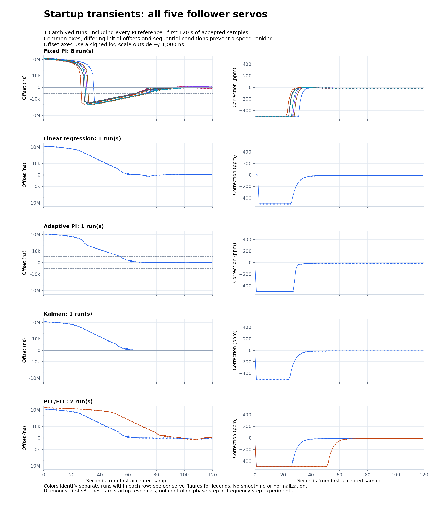
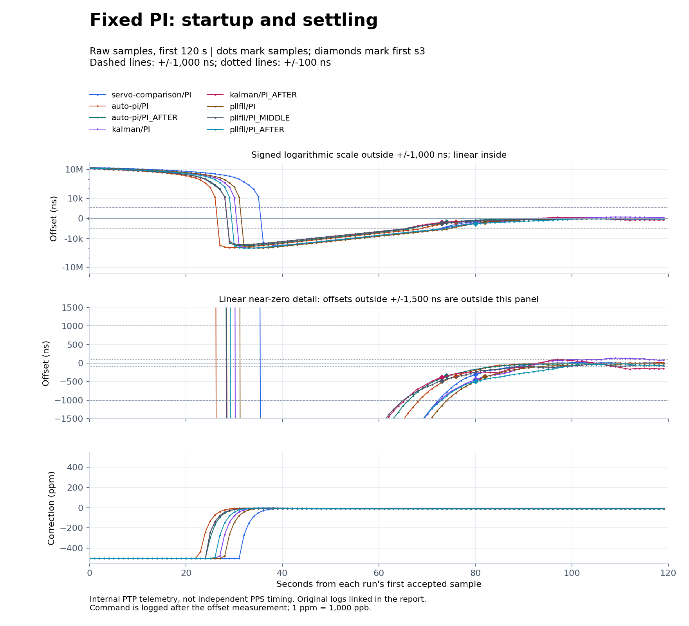
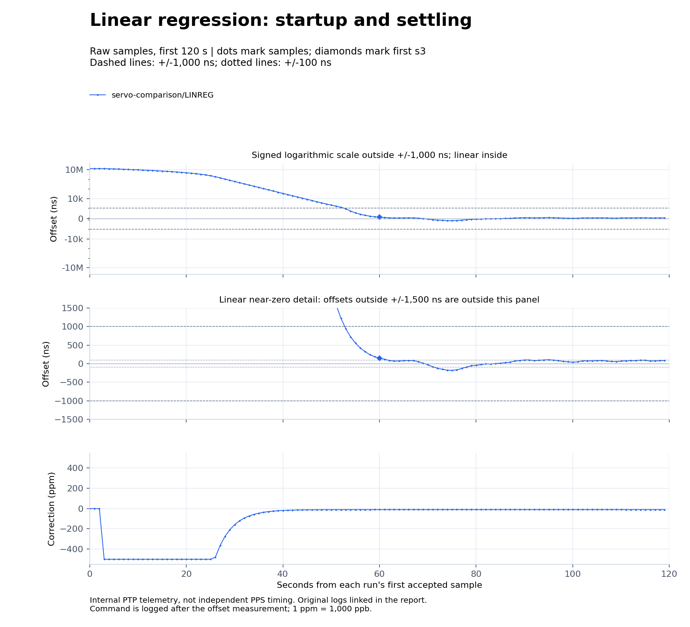
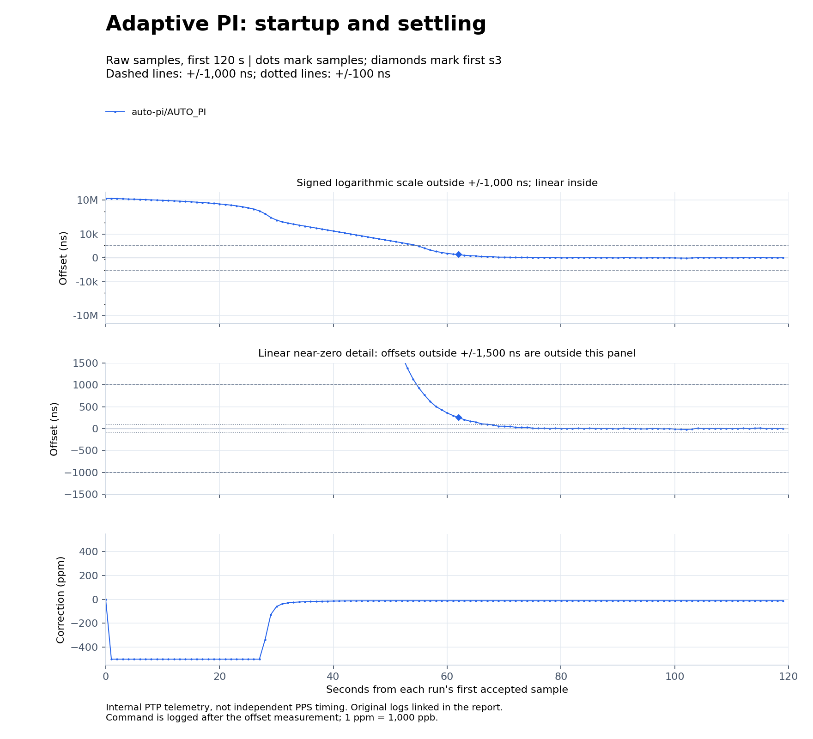
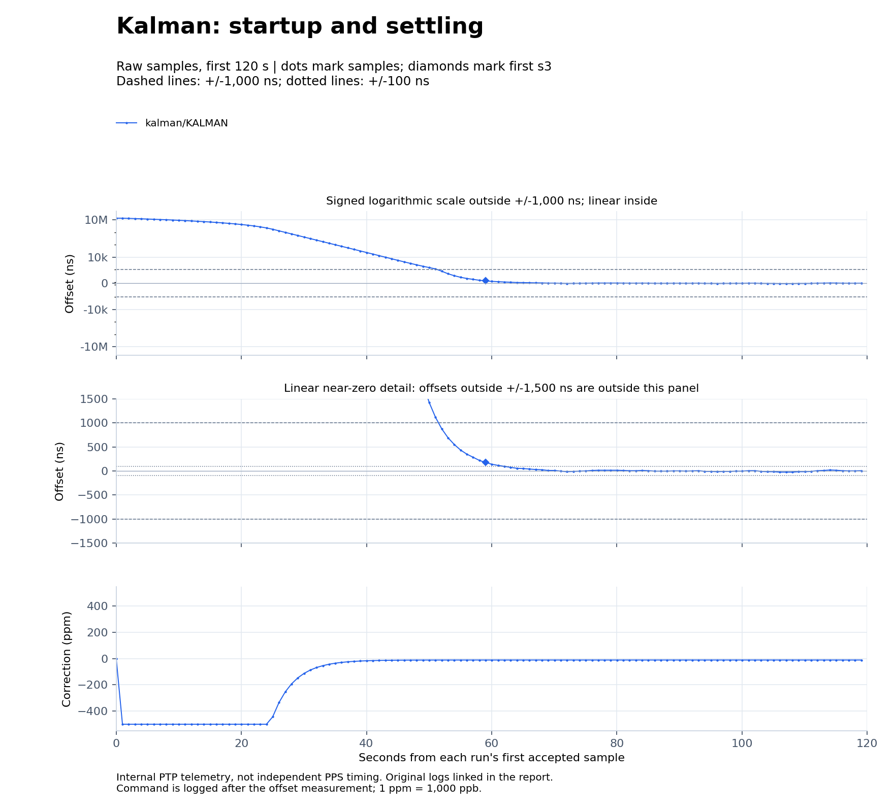
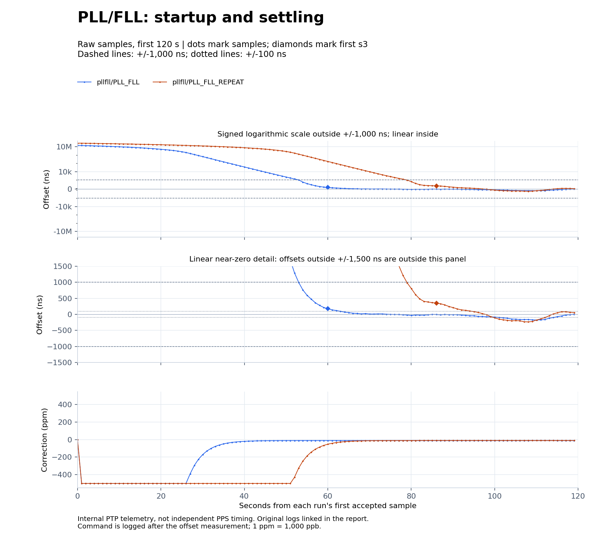

# Startup transients for all five follower servos

This report adds a consistent startup analysis to the existing hardware trials.
It reuses **13 archived comparison runs and 3,722 accepted exchanges** collected
on October 13 and 14, 2026 (Pacific time): eight fixed-PI references, one linreg,
one adaptive PI, one Kalman, and two PLL/FLL runs. Every run in the four
published comparison JSON files is included. No new hardware run, injected
disturbance, firmware upload, or change to the installed PI servo was needed.
Warm-ups, failed initializations, and the separate 15-minute PI run are outside
this defined comparison dataset. Their original reports remain available.



The left panels show signed offset; the right panels show the frequency
command. All rows use the same time and vertical limits. The offset scale is
linear within +/-1,000 ns and logarithmic outside that region, preserving the
sign while showing millisecond acquisition and nanosecond residuals together.
It is not a linear display of slope or damping. Diamonds mark the first `s3`
sample. Colors identify separate runs within a row, not a common trial across
rows; the individual figures below provide the run legends.

## What is measured

The transient begins at the **first accepted PTP exchange**, not power-on,
Ethernet initialization, master selection, or a deliberately injected clock
step. The first sample's boot uptime is retained in the machine-readable
metrics. Positive offset means the follower clock is ahead of the grandmaster.
The recorded frequency command is issued **after** measuring that sample's
offset, so its effect appears in subsequent samples. The figures use ppm for
readability; serial logs use ppb (1 ppm = 1,000 ppb).

All 13 records contain a single boot, no coarse-step samples, and no sample
number gaps. Initial offsets range from **12.05 to 26.63 ms**. The first
120 seconds are shown without smoothing, decimation, outlier removal, or
normalization by initial offset. Metrics use the following explicit definitions:

| Metric | Definition |
| --- | --- |
| First `s3` | First logged `s3`; firmware requires eight consecutive accepted offsets within +/-1,000 ns. It is a status threshold, not an accuracy certificate. |
| Settle +/-1 us or +/-100 ns | First sample in the final uninterrupted in-band suffix of the **entire capture**, with at least 30 seconds remaining. Any later out-of-band sample invalidates an earlier entry. Missing sample numbers or a gap above 1.5 seconds break the observation. |
| Not demonstrated (`ND`) | No qualifying suffix in this finite record. This does not prove the servo can never settle. |
| Opposite-side peak | Largest signed excursion opposite the initial offset during `0 <= t < 120 s`. This is an observed startup overshoot, not a standard percentage overshoot from a controlled step-response test. |
| Clamp samples | Number of accepted samples in `0 <= t < 120 s` whose command is at +/-500,000 ppb. This is a sample count, not an exact saturation duration. |

Every capture lasts about 285 to 287 seconds from first to last accepted
exchange. Settling checks use those complete records even though the transient
figures stop at 120 seconds. The exported [samples CSV](plots/samples.csv)
retains all 3,722 samples. Values in the table are rounded for display; the
[JSON](plots/metrics.json) and [metrics CSV](plots/metrics.csv) retain the
serial time resolution and integer offset values. Individual source log hashes
are verified against their original comparison metadata before plotting.

## Measured startup metrics

All times below are seconds from the first accepted sample. All initial
offsets are positive; opposite-side peaks are negative. `ND` is defined above.

| Run | Initial offset (ms) | First s3 (s) | Settle +/-1 us (s) | Settle +/-100 ns (s) | Opposite peak (ns) | Clamp samples |
| --- | ---: | ---: | ---: | ---: | ---: | ---: |
| [servo-comparison/PI](../../../results/2026-10-13/servo-comparison/servo-pi-20261013-01-follower.log) | 16.1609 | 80.033 | 73.030 | ND | -49,450 | 32 |
| [servo-comparison/LINREG](../../../results/2026-10-13/servo-comparison/servo-linreg-20261013-01-follower.log) | 13.1134 | 60.023 | 53.021 | 125.054 | -180 | 23 |
| [auto-pi/PI](../../../results/2026-10-13/auto-pi/autopi-baseline-20261013-01-follower.log) | 12.0480 | 76.029 | 69.026 | 83.033 | -87,005 | 23 |
| [auto-pi/AUTO_PI](../../../results/2026-10-13/auto-pi/autopi-adaptive-20261013-01-follower.log) | 13.8240 | 62.024 | 55.021 | 67.026 | -20 | 27 |
| [auto-pi/PI_AFTER](../../../results/2026-10-13/auto-pi/autopi-after-20261013-01-follower.log) | 12.7820 | 74.030 | 67.028 | 84.035 | -55,730 | 25 |
| [kalman/PI](../../../results/2026-10-13/kalman/kalman-baseline-20261013-02-follower.log) | 14.0979 | 80.031 | 73.029 | 125.053 | -97,510 | 27 |
| [kalman/KALMAN](../../../results/2026-10-13/kalman/servo-kalman-20261013-01-follower.log) | 13.4723 | 59.025 | 52.020 | ND | -25 | 24 |
| [kalman/PI_AFTER](../../../results/2026-10-13/kalman/kalman-restore-pi-20261013-01-follower.log) | 12.6849 | 73.029 | 66.026 | ND | -43,695 | 25 |
| [pllfll/PI](../../../results/2026-10-14/pllfll/pi-01-follower.log) | 14.5765 | 82.033 | 75.031 | 93.039 | -97,490 | 28 |
| [pllfll/PLL_FLL](../../../results/2026-10-14/pllfll/pllfll-01-follower.log) | 14.2337 | 60.023 | 53.020 | ND | -175 | 26 |
| [pllfll/PI_MIDDLE](../../../results/2026-10-14/pllfll/pi-02-follower.log) | 12.6782 | 73.030 | 66.027 | ND | -42,815 | 25 |
| [pllfll/PLL_FLL_REPEAT](../../../results/2026-10-14/pllfll/pllfll-02-follower.log) | 26.6343 | 86.035 | 79.033 | ND | -235 | 51 |
| [pllfll/PI_AFTER](../../../results/2026-10-14/pllfll/pi-03-follower.log) | 13.6186 | 80.032 | 73.029 | ND | -100,555 | 26 |

All runs remain in `s3` after their first `s3` sample. Nevertheless, seven of
the 13 runs do not demonstrate sustained +/-100 ns settling under this
criterion. The eight-sample lock indicator is deliberately looser than that
band. The +/-1 us settling time precedes first `s3` by about seven seconds in
these uninterrupted 1 Hz captures, as expected from the eight-sample rule.

## Fixed PI: saturation, overshoot, and recovery



The fixed PI controller commands -500 ppm immediately for these positive
initial offsets. Its proportional/integral law and bounded integral then bring
the phase through zero. The observed opposite-side peaks range from
**-42,815 to -100,555 ns**, followed by a slower recovery from negative phase.
First `s3` ranges from **73.029 to 82.033 s** across eight reference runs.
The traces illustrate repeatability of this overall shape, as well as variation
in starting offset and residual noise. They do not identify temperature or
oscillator drift separately.

The linear middle panel deliberately shows only +/-1,500 ns. Earlier values
are outside its limits, not removed from the dataset; the upper panel retains
them. Lines join adjacent samples and should not be read as higher-rate
measurements of the crossing. Four PI captures demonstrate sustained +/-100 ns
settling; four do not within their finite observation windows.

## Linear regression: initial fit and gradual approach



Linreg collects at least four points before issuing its first fitted command.
It estimates free-running frequency from a rolling eight-point window after
accounting for commands already applied, then removes fitted phase over four
seconds. The initial near-zero command segment and subsequent saturated segment
are visible. In this capture, first `s3` is **60.023 s**, the opposite-side peak
is **-180 ns**, and sustained +/-100 ns settling begins at **125.054 s**.
That last value is outside the 120-second plot: later small excursions matter
when deciding whether a band is maintained. This single run is not evidence
of consistent superiority over PI or of LinuxPTP linreg behavior; this is the
repository's independent fixed-window implementation.

## Adaptive PI: fast acquisition is distinct from later tuning



The controller starts in Fast mode (Kp 0.750, Ki 0.125), holds the previous
command on its first sample, and then uses its bounded integral and output.
It reaches `s3` at **62.024 s** with an opposite-side peak of **-20 ns** during
the first 120 seconds. Sustained +/-100 ns settling starts at **67.026 s**.

The early startup should not be attributed to repeated gain switching. The
first logged switch to Normal occurs at boot uptime 130.878 s, near the end of
the plotted acquisition window; later switches appear in the original
[gain telemetry and comparison](../../2026-10-13/auto-pi/README.md).
Adaptive PI also changes integral precision and interval handling, so this
experiment does not isolate gain scheduling. Its smoother startup coexists
with higher steady-state RMS than both adjacent fixed-PI references.

## Kalman: estimated phase and frequency



Kalman anchors the first sample, then predicts phase using elapsed time and
the previous command, corrects its phase/frequency estimates, and steers with
a four-second phase time constant. The startup plot shows the saturated command
followed by a gradual approach to zero. First `s3` is **59.025 s** and the
first-120-second opposite-side peak is **-25 ns**.

Sustained +/-100 ns settling is **not demonstrated** over the whole record,
despite the small early overshoot. Later raw offsets extend to +305 ns in the
original fixed-cutoff window. The plotted offset is the original PTP
measurement, not the filter's internal smoothed phase estimate. The provisional
noise parameters were fixed for this run; this is not evidence of optimal
Kalman tuning. See the [hardware comparison](../../2026-10-13/kalman/README.md).

## PLL/FLL: the initial phase burden matters



The fixed-point hybrid anchors its first sample, estimates intrinsic frequency
over eight accepted intervals with prior-command compensation, and combines
that estimate with a four-second phase correction. The first run starts at
**14.23 ms**, while the repeat starts at **26.63 ms**. The repeat spends **51**
accepted samples at the correction limit, compared with **26** in the first
run. First `s3` moves from **60.023 to 86.035 s**.

This difference is consistent with a larger initial phase burden under the
same bounded slew rate; it is not evidence that the algorithm became slower.
The opposite-side peaks in the first 120 seconds are **-175 and -235 ns**.
Neither run demonstrates sustained +/-100 ns settling across its full record.
Both had worse steady-state RMS than adjacent PI references, as recorded in the
[alternating hardware trials](../pllfll/README.md).

## What the comparisons establish, and what comes next

These traces establish the observed startup shapes under the tested firmware
and direct-link conditions. They separate three different questions:

1. How quickly a large initial phase error is removed under output saturation.
2. How the controller approaches zero, crosses it, and satisfies a lock band.
3. How much residual error remains after acquisition, including later wander.

A small startup overshoot does not guarantee lower steady-state RMS. Conversely,
a controller can have a visible startup overshoot and still provide a quieter
steady-state window. The default remains fixed PI based on the available
hardware evidence; this report does not choose a new winner.

A controlled follow-up should first lock each servo, inject the same positive
and negative phase steps below the 500 ms coarse-step threshold, then separately
apply known frequency disturbances. Repeat each condition, alternate reference
runs, and capture the actual actuation timestamp. Report recovery bands,
overshoot, clamp time, and post-recovery RMS for each condition. Packet-loss
recovery and holdover require separate experiments. Those tests have **not**
been performed here, and the present startup logs must not be presented as
their results. Independent, calibrated PPS timing is also still needed to
assess physical output alignment rather than internal PTP telemetry.

## Reproduce

From the repository root, with Python 3 and matplotlib:

```sh
python3 tools/plot_transients.py \
  docs/results/2026-10-13/servo-comparison/plots/comparison.json \
  docs/results/2026-10-13/auto-pi/plots/comparison.json \
  docs/results/2026-10-13/kalman/plots/comparison.json \
  docs/results/2026-10-14/pllfll/plots/comparison.json \
  --output-dir docs/results/2026-10-14/transients/plots
python3 -m unittest discover -s tests -p 'test_*.py'
```

The script checks each input log against its previously published SHA-256,
requires one boot, and cross-checks sample counts and first-s3 times against
the original metadata. It writes six figures in PNG and SVG, the complete
combined sample CSV, and JSON/CSV metrics. The unit tests cover late band exits,
short tails, missing samples, time gaps, negative starting offsets, the
120-second boundary, and zero initial offset. Existing firmware and archived
captures are unchanged. [SHA256SUMS](SHA256SUMS) covers this report and its
outputs; re-rendered image hashes can vary with plotting-library versions.
