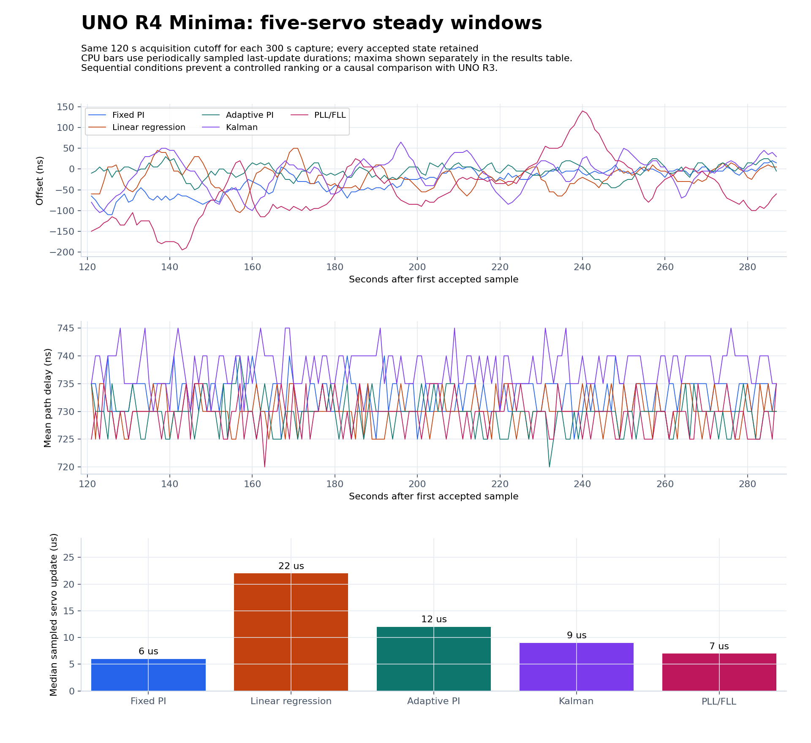
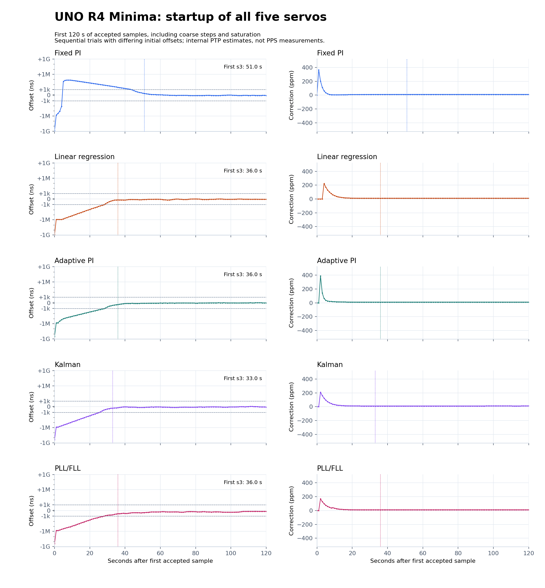
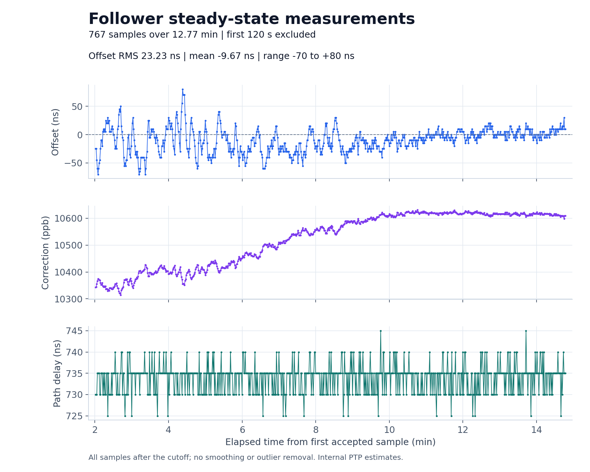

# UNO R4 Minima port and hardware experiment

Experiment date: October 14, 2026 Pacific (October 15 UTC for serial captures).
Two UNO R4 Minima boards replaced the UNO R3s. Each carries the existing
MAX3421E USB Host Shield and AX88279 TimeStick, with direct Ethernet between
the sticks. The upload/capture host is an Intel Mac (Darwin 25.6.0).

**Completed:** five 300-second servo trials and a 900-second fixed-PI run,
from **2026-10-15 00:43:19 to 01:24:49 UTC**. All **2,328 accepted follower
samples** were captured without sample-number gaps. Both boards remain
programmed with automatic roles: grandmaster and fixed-PI follower.

## Board and clock identities

| Role | R4 USB serial | Serial port during capture | TimeStick clock identity |
| --- | --- | --- | --- |
| Grandmaster | 64,096 | 9,080 | 65,016 | 8,848 |
| Follower | `320D072639313139112733354B57336E` | `/dev/cu.usbmodem3201` | `9c69d3.fffe.2ba18d` |

These TimeStick roles are reversed relative to the archived R3 pair. Do not
compare correction signs or identify boards using the old serial suffixes.
USB IDs are Arduino `2341:0069` in application mode and `2341:0369` in DFU mode.
Uploads select the full USB serial, not an ambiguous VID/PID or port number.

## Build and software validation

- Arduino CLI 1.5.1, Arduino UNO R4 Boards (`renesas_uno`) 1.6.0.
- USB Host Shield Library 2.0 1.7.0, pyserial 3.5 for capture.
- **Hardware trial images:** native Arm GNU Toolchain 13.3.Rel1 on Apple silicon,
  overriding only `compiler.path` in the official core configuration.
- **Additional compile validation:** all seven examples also build using the
  official bundled `arm-none-eabi-gcc 7-2017q4` on the Intel capture host. Those
  separate binaries are not the images used for the trial results.
- FPU flags: `-mcpu=cortex-m4 -mfpu=fpv4-sp-d16 -mfloat-abi=hard`.
  Kalman disassembly includes single-precision floating-point instructions.
- All seven classic UNO examples still compile with AVR core 1.8.8 and the
  native QMK AVR GCC 15.2.0 toolchain. R3 builds retain the 256-byte buffer,
  one-round polling budget, and disabled CPU profiling.
- Eight native C++ suites passed with address/undefined-behavior sanitizers.
  The protocol harness additionally passed with both R3 and R4 configurations
  for each of the five servo selections, including 20,000 randomized aggregates
  per run and first-exchange/runtime step boundaries.
- Thirteen Python analysis tests passed, including nonzero boot timestamps,
  settling criteria, checksum rejection and retention of non-s3 steady samples.
- The development ZIP installs into an isolated Arduino sketchbook, all seven
  examples are discovered, and its packaged Kalman example builds with the
  bundled R4 toolchain. No graphical IDE interaction was required.

Flash and static RAM are compiler reports, not measured stack high-water marks.
The R4 has 262,144 flash bytes and 32,768 RAM bytes. Heap and runtime stack
usage are not measured.

| Example | GCC 13 flash | GCC 13 static RAM | Bundled GCC 7 flash | Bundled GCC 7 static RAM |
| --- | ---: | ---: | ---: | ---: |
| FollowerAdaptivePI | 64,996 | 9,100 | 66,012 | 8,868 |
| FollowerKalman | 64,612 | 9,100 | 65,548 | 8,868 |
| FollowerLinreg | 64,656 | 9,224 | 65,640 | 9,000 |
| FollowerPI | 64,084 | 9,080 | 65,004 | 8,848 |
| FollowerPllFll | 64,424 | 9,104 | 65,420 | 8,880 |
| Grandmaster | 64,096 | 9,080 | 65,016 | 8,848 |
| TimeStickProbe | 63,860 | 9,076 | 64,820 | 8,848 |

[Full R3/R4 compile matrix](build-matrix.json)
| [Toolchain sizes and image hashes](builds/summary.json)
| [Bundled-toolchain build logs](builds)

## Bring-up and capture method

Initial boots enumerated the sticks and negotiated Ethernet, but the clock
request `0x13` returned USB STALL `0x05`. Automatic retries subsequently
recovered both clocks without an operator power cycle. This confirms recovery
for this attempt, not a general fix for the previously observed restart issue.
PPS gate `0x4000`, clock control `0x5F`, and active interval 500,000,000 ns were
read back on both sticks. No oscilloscope measurement was made in this run.

The dedicated capture sequence reuploads the grandmaster once, then captures
five 300-second follower trials in order: PI, linreg, adaptive PI, Kalman,
PLL/FLL. It ends with a fresh 900-second PI capture. Grandmaster serial is
recorded continuously across the sequence. Each follower capture starts after
its upload, includes its actual boot marker, and uses 115200-baud native USB
CDC. No invented boot markers or interpolated PTP samples are inserted.

The same 120-second cutoff after the first accepted exchange defines each
steady window. All samples after that cutoff remain, including any non-s3
states or excursions. Startup plots include coarse steps and saturation.
Settling requires a final uninterrupted in-band suffix lasting at least 30 s;
the finite record cannot prove indefinite lock.

The Cortex-M4F port uses a 4096-byte aggregate buffer and at most four receive/
TX-timestamp polling rounds per loop. Five servo algorithms and gains remain
the same as the R3 source. R4 first-exchange stepping changes from 500 ms to
1 ms; later exchanges retain the 500 ms threshold. Arduino uploads do not
establish a common initial TimeStick phase, so this avoids minutes of
saturated startup slewing for initial offsets below 500 ms. Tests exercise both signs,
the exact threshold, and the distinct first-exchange/runtime rules on both
architectures. `servo_last_us` measures only filter arithmetic;
`usb_poll_max_us` includes packet handling, callbacks and clock/serial I/O.
The periodic last-update median is sampled telemetry, not a median over every
individual servo execution.

The final sequence is remote attempt `trials-04`, archived here as `trials/`.
It used the temporary macOS sleep assertions and completed independently of
SSH connectivity. Every capture has exactly one real boot marker, the expected
servo name and R4 platform banner, and a matching SHA-256. Uploaded image
hashes match the Arm GCC 13 build record. The preliminary attempts are retained
in [bringup](bringup/README.md), with their sleep gaps and old-threshold startup
behavior documented separately.

The master log contains one MCU boot and six Ethernet link-down/reinitialization
events, one for each follower upload/startup. Its role counters restart after
these automatic reinitializations. The master was not an uninterrupted clock
reference across the upload boundaries; compare each individual follower run.
Within the completed captures, follower sample numbering is continuous. All
reported master/follower timeout, missing-RX and discard counters are zero;
there are no rejected paths or initialization failures in the final sequence.

## Five-servo comparison

Each 300-second capture contains 288 accepted exchanges. The common 120-second
cutoff leaves 167 samples over 166 seconds per servo, all in s3. The first
accepted sample is a coarse clock step in each run. The short windows show:

| Servo | Offset RMS | Offset range | First s3 | Median sampled update | Peak update in steady window |
| --- | ---: | ---: | ---: | ---: | ---: |
| Fixed PI | 41.01 ns | -110 to +20 ns | 50.99 s | 6 us | 9 us |
| Linear regression | 33.93 ns | -105 to +50 ns | 35.99 s | 22 us | 25 us |
| Adaptive PI | 16.35 ns | -50 to +30 ns | 36.00 s | 12 us | 15 us |
| Kalman | 40.77 ns | -105 to +65 ns | 32.99 s | 9 us | 11 us |
| PLL/FLL | 83.83 ns | -195 to +140 ns | 35.99 s | 7 us | 11 us |



Adaptive PI had the lowest RMS in this sequence, but it is one sequential
trial per servo, with different oscillator drift and starting offsets. Fixed
PI remains the default. The 9 us Kalman update demonstrates that the existing
filter runs comfortably on the R4; it is not a measured R3-to-R4 speedup.
Linreg's integer regression costs more CPU here than the hardware-float
Kalman filter. Even the largest measured update is small relative to the 1 Hz
exchange period. USB polling sections reached about 3.1 to 3.8 ms in steady
windows, including parsing, callbacks and clock/serial I/O.

## Startup transients

Times below start at the first accepted exchange, not power-on. The final
in-band suffix must last at least 30 seconds to count as settled. Initial
offsets differ, so these are observed trajectories rather than a controlled
acquisition-speed ranking.

| Servo | Initial offset | Settled within +/-1,000 ns | Settled within +/-100 ns |
| --- | ---: | ---: | ---: |
| Fixed PI | -861.929 ms | 43.99 s | 126.99 s |
| Linear regression | -868.118 ms | 28.99 s | 157.99 s |
| Adaptive PI | -330.405 ms | 29.00 s | 44.00 s |
| Kalman | -254.350 ms | 25.99 s | 123.99 s |
| PLL/FLL | -256.198 ms | 28.99 s | 242.99 s |



The adaptive-PI, Kalman, and PLL/FLL starts also exercise the new first-exchange
rule on hardware: each starts below the old 500 ms threshold and records s1
and a clock step. Subsequent small excursions use the frequency servo.

## Longer fixed-PI run

The 900-second capture contains **888 exchanges**. After the same 120-second
cutoff, **767 samples over 766 seconds** remain, all in s3:

- Offset RMS **23.23 ns**, mean **-9.67 ns**, population standard deviation **21.12 ns**.
- Offset range **-70 to +80 ns**; no missing sample numbers.
- Mean path estimate **733.82 ns**; range **725 to 745 ns**.
- Longest accepted-sample interval **1.001 s**.
- Median sampled PI update **6 us**, maximum **7 us** in this steady window.



The lower RMS than the earlier short PI trial shows why a short sequential
comparison is not a definitive servo ranking. No calibrated physical PPS
measurement was made during this session.

## Data and example output

[Capture manifest and image hashes](trials/manifest.json)
| [Grandmaster log](trials/grandmaster.log)
| [Long follower log](trials/pi-steady.log)
| [All servo metrics and transient statistics](plots/summary.json)
| [Extracted samples and CPU telemetry](plots)
| [Long-run statistics](steady-state/steady-state-summary.json)

Consecutive final status lines from the master:

```text
tinyptp[2480.161]: CPU servo_last_us 0 servo_max_us 0 usb_poll_max_us 1214
tinyptp[2480.161]: port 1: MASTER sync 887 delay_resp 887 freq +0 timeouts 0 missing_rx 0 discarded 0
tinyptp[2481.161]: CPU servo_last_us 0 servo_max_us 0 usb_poll_max_us 1221
tinyptp[2481.161]: port 1: MASTER sync 888 delay_resp 888 freq +0 timeouts 0 missing_rx 0 discarded 0
```

The master runs no follower servo, so its servo timing fields are zero.
Both sketches print at 115200 baud without a host-issued start command.

Consecutive final follower samples:

```text
tinyptp[898.080]: master offset 30 s3 freq +10599 path delay 735 sample 886 seq 886
tinyptp[899.079]: master offset 10 s3 freq +10609 path delay 735 sample 887 seq 887
tinyptp[900.079]: master offset 10 s3 freq +10609 path delay 735 sample 888 seq 888
```

[Archive checksums](SHA256SUMS) cover the raw logs, manifests, build records,
analysis files and rendered figures. Serial log CRLF bytes are preserved.

## Reproduce

See the [R4 guide](../../../uno-r4-minima.md) for compilation, installation and
`tools/run_r4_trials.py` arguments. Analyze the completed capture directory:

```sh
python3 tools/plot_r4_trials.py docs/results/2026-10-14/uno-r4-minima/trials \
  --output-dir docs/results/2026-10-14/uno-r4-minima/plots
python3 tools/plot_steady_state.py docs/results/2026-10-14/uno-r4-minima/trials/pi-steady.log \
  --output-dir docs/results/2026-10-14/uno-r4-minima/steady-state --after 120
```

These are sequential experiments with uncontrolled temperature and oscillator
drift. Comparing a historical R3 run with a current R4 run does not isolate
processor effects. Offset/path values are internal PTP estimates, not calibrated
PPS, UTC or end-to-end accuracy measurements. The grandmaster is free-running.
