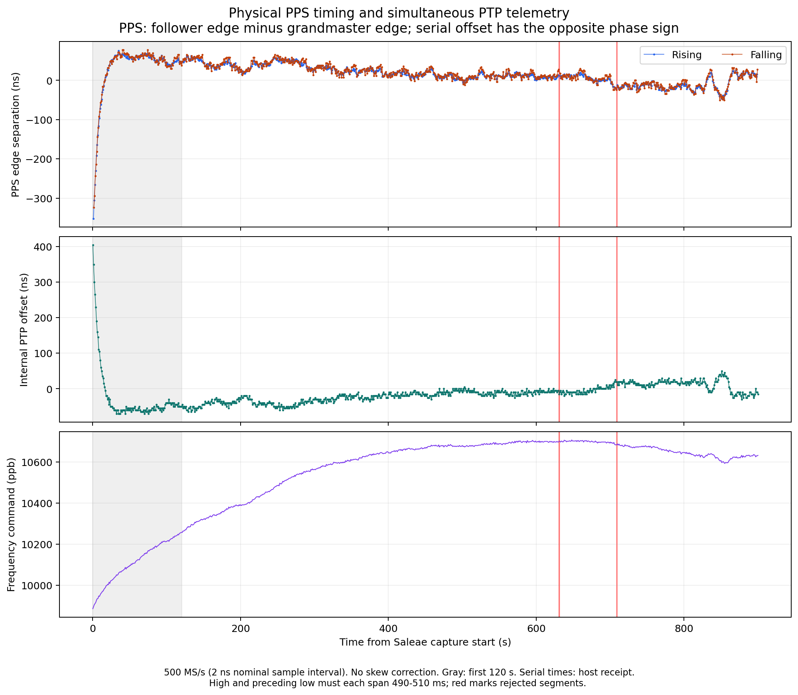
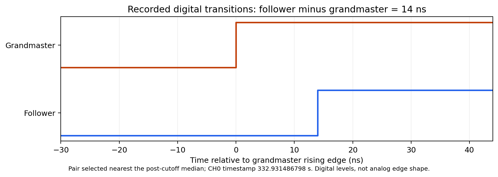
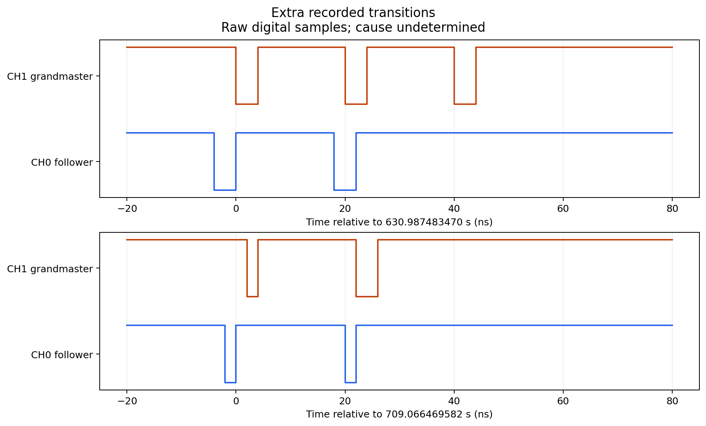
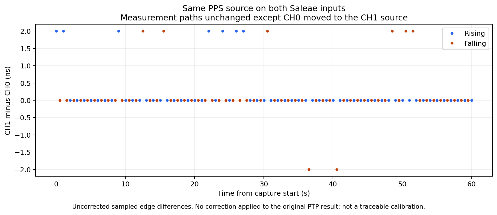

# Independent PPS capture, UNO R4 Minima pair

On October 16, 2026, a Saleae Logic Pro 8 recorded both TimeStick PPS outputs
for **900.091 seconds at 500 MS/s**, simultaneously with both Arduino serial
ports at 115200 baud. The follower used fixed PI. The grandmaster was
free-running. This is a separate follow-up to the earlier five-servo campaign,
not a physical measurement of all five servos.

After a 120-second cutoff, the qualified rising edges have **26.18 ns RMS
separation**, a **+14.59 ns mean**, and a **-46 to +64 ns range**. Positive means
the follower edge arrives later. These are uncorrected relative measurements,
not calibrated timing accuracy or UTC accuracy. The recording contains two
bursts of extra transitions, detailed below; this is not a glitch-free result.



## Setup and channel identity

| Item | Recorded configuration |
| --- | --- |
| Controllers | Two UNO R4 Minima boards, MAX3421E USB Host Shields |
| Timing hardware | Two AX88279-based TimeSticks, direct Ethernet |
| CH0 | Follower, `9c69d3.fffe.2ba18d` |
| CH1 | Grandmaster, `9c69d3.fffe.2ba12f` |
| Serial log 0 | Grandmaster, `/dev/cu.usbmodem2101` |
| Serial log 1 | Follower, `/dev/cu.usbmodem3201` |
| Servo | Fixed PI, startup reports `kp 1/2 ki 1/20 limit 500000 ppb` |
| Instrument | Saleae Logic Pro 8, `DE6166D1E5FB7317` |
| Software | Logic 2.4.48, automation 1.0.11, pyserial 3.5 |
| Sampling | Digital channels 0 and 1, 500 MS/s, no glitch filter |
| Threshold | `3.3+ V` logic preset, nominal switching threshold about 1.65 V |
| PPS gate | 500 ms high, confirmed in startup register readback |
| Leads | User confirmed same type and approximately equal length |
| Ground | User confirmed Saleae ground connected to TimeStick signal ground |
| Reference | No external frequency reference or UTC traceability |

The 3.3 V API value selects a logic preset; it is not a 3.3 V comparator
threshold. See the [Logic Pro 8 specifications](https://downloads.saleae.com/specs/logic_pro_8_data_sheet.pdf).
Exact cable lengths, propagation delays, temperature, and additional termination
were not measured. There is no traceable calibration or applied channel-skew
correction. A subsequent same-source channel/lead comparison is reported below.

The channel roles were established from the actual startup capture
[`bringup/probe-02`](bringup/probe-02): CH0's phase step and recovery follow the
follower serial trace, while CH1 maintains a nearly constant period. Serial
startup messages identify the two clocks. No firmware was changed during this
measurement session; running roles and PI settings were observed in the logs.

Both assemblies were fully power-cycled immediately before startup capture.
The long capture began roughly 70 seconds into follower uptime; its first
120 seconds are excluded from the post-cutoff summary. This cutoff does not
establish thermal equilibrium or stationary noise. The frequency-command trace
continues to change over the record.

## Results

Statistics use population standard deviation and RMS about zero. No phase
outliers are removed, and no detrending, cable correction, or skew correction
is applied. PPS statistics require a complete high and preceding low, each 490 to 510 ms,
with the quality rule and exclusions described below.

| Observable after 120 s | Count | Mean (ns) | Standard deviation (ns) | RMS (ns) | Min / max (ns) |
| --- | ---: | ---: | ---: | ---: | ---: |
| Rising PPS, follower minus grandmaster | 777 | +14.59 | 21.74 | 26.18 | -46 / +64 |
| Falling PPS, follower minus grandmaster | 778 | +16.16 | 22.71 | 27.87 | -50 / +66 |
| Internal PTP offset estimate | 781 | -14.33 | 21.85 | 26.13 | -65 / +50 |

The full capture retains **897 qualified complete pulse pairs**, with rising
edge RMS **38.17 ns**, mean **+16.50 ns**, and range **-352 to +76 ns**. Its
falling edge RMS is **38.34 ns**, mean **+18.22 ns**, and range **-324 to +78 ns**.
The cutoff is applied to each edge's CH0 timestamp, so rising and falling
post-cutoff counts differ by one.

There are **901 serial offset samples**, no sample-number gaps, no clock-step
or link-loss messages, and zero reported grandmaster timeout, missing-RX,
and discarded counters. All **781 post-cutoff serial samples are in s3**.
Serial times on the graph are host receipt times, not hardware timestamps.
They support a simultaneous comparison but do not pair individual serial
estimates with specific PPS edges. A positive clock-phase offset means an
earlier physical PPS edge, so the phase and edge-arrival signs are opposite.



This detail shows the recorded digital transitions nearest the post-cutoff
median, **14 ns**. It represents threshold crossings sampled by the logic
analyzer, not analog edge shape or rise time.

## Extra transitions and pulse qualification

The strict analysis initially rejected the recording because closely spaced
edges make naive PPS pairing ambiguous. The unmodified CSV and binary exports
agree: both inputs have extra transitions around **630.987483 s** and
**709.066470 s**, within two PPS high portions. Their cause is undetermined.
The serial logs show no corresponding exchange loss or clock step.



After observing these events, the analysis introduced an explicit duration
rule: accept a complete, continuous high pulse only if both its high duration
and its preceding continuous low duration are between 490 and 510 ms, inclusive,
consistent with the configured 500 ms gate. The preceding-low requirement was
added after the final wiring check exposed notches near rising edges; it prevents
using a later transition as a replacement PPS edge and does not change the
long-run counts or statistics. This
rule is independent of measured inter-channel phase, but it was chosen after
inspection and is not a predeclared selection criterion. It excludes both
affected whole PPS cycles, all their short segments, and the partial pulses
at the beginning and end of the capture. A pulse without an observed preceding
falling edge is also excluded. It does not stitch interruptions
together or silently suppress transitions.

Raw CH0 has 904 rising and 904 falling transitions; CH1 has 905 of each.
Each channel retains 897 complete qualifying pulses. Every rejected complete
segment and every excluded edge timestamp is enumerated in
[`plots/pps-summary.json`](plots/pps-summary.json). All raw samples are retained.
The period-gap fields in that summary describe the qualified series, including
the two deliberate cycle exclusions, rather than claiming missing source PPS.
The reported RMS therefore characterizes the qualified pulses, not an
uninterrupted, validated PPS stream. A longer clean repeat and investigation
of these disturbances remain necessary.

## Same-source measurement-path check

After the baseline was saved, the operator moved only CH0's signal lead to
share the PPS output already feeding CH1. Both inputs then measured the
same grandmaster PPS, with the measurement leads and grounds otherwise
unchanged. The second capture lasted **60.095 seconds** at the same 500 MS/s
and threshold preset. It contains **61 rising pairs and 60 falling pairs**,
no unmatched edges, and no closely spaced extra transitions. No pulse-duration
qualification or transient cutoff was needed for this check.

| Same-source observable, CH1 minus CH0 | Count | Mean (ns) | Standard deviation (ns) | Range (ns) |
| --- | ---: | ---: | ---: | ---: |
| Rising | 61 | +0.230 | 0.637 | 0 to +2 |
| Falling | 60 | +0.133 | 0.718 | -2 to +2 |



These small sampled differences are consistent with measurement-path skew
being small in this particular setup. They do not establish sub-nanosecond
accuracy, explain the earlier disturbances, or calibrate the two distinct
TimeStick output paths. Sharing one output also changes its loading. The main
PTP results remain **uncorrected**. This short check is an empirical fixture
observation, not a traceable calibration or a bound on every systematic error.

The native file, exports, and hash manifest are in
[`same-source-01`](same-source-01); derived edge pairs and statistics are in
[`same-source-plots`](same-source-plots).

## Wiring-restoration check

The operator then returned CH0 to the original follower output. A separate
**30.014-second** capture, [`restored-01`](restored-01), confirms both PPS signals
and 30 in-capture follower serial samples, all in s3 with no sample gaps. This
is a short diagnostic, not a replacement for the long run.

It is **not clean**: CH1 has five 14 to 16 ns high segments followed by a 2 ns
low notch near rising edges, at approximately 15.379111, 17.378857, 22.378221,
23.378094, and 27.377586 seconds. CH0 has no corresponding extra transitions.
The cause remains undetermined. The duration rule excludes the five disturbed
cycles on CH1 and the initial pulse with an incomplete preceding low, retaining
24 matched qualified pulse pairs. The five unmatched qualified CH0 pulses are
explicitly reported; they do not imply missing source pulses.

[Derived diagnostic plots and statistics](restored-plots) retain the observed
notches. This capture supports further signal-path investigation and a longer
clean repeat, rather than a claim of an uninterrupted validated PPS stream.
Both boards remained running; no firmware or servo settings were changed.

## Measurement limits

500 MS/s gives a **2 ns nominal sample interval**, not 2 ns timing accuracy.
Saleae describes asynchronous interval quantization of up to one sample
period and a Pro-series timebase specification of +/-50 ppm in its
[time measurement error guidance](https://www.saleae.com/support/troubleshooting/capture-and-recording-issues/time-measurement-error).
Its [channel-skew guidance](https://www.saleae.com/support/specifications-hardware/electrical-characteristics/worst-case-channel-skew)
also discusses sampled-edge and propagation/threshold effects. These vendor
descriptions do not constitute calibration of this individual instrument.

Matching lead type and approximate length reduces one obvious fixture
difference. The same-source check observes the combined measurement-path
difference under its specific conditions; it does not separate lead delay,
channel skew, threshold effects, or TimeStick output asymmetry. No uncertainty budget, UTC claim, analog waveform
measurement, or causal attribution of the observed mean is made. Channel/cable reversal, role reversal, and longer clean repeat runs are still
useful.

## Archive and reproduction

- [`SHA256SUMS`](SHA256SUMS): hashes of this archived report, data, and plots.
- [`setup.json`](setup.json): setup observations and user-confirmed wiring.
- [`steady-01/capture-manifest.json`](steady-01/capture-manifest.json): settings,
  timestamps, software versions, device identity, and raw-file SHA-256 hashes.
- [`steady-01/pps.sal`](steady-01/pps.sal): native Saleae recording.
- [`steady-01/digital.csv`](steady-01/digital.csv): unmodified digital export.
- `steady-01/digital_0.bin` and `digital_1.bin`: independent binary exports.
- `steady-01/serial-0.log`, `serial-1.log`, and `serial-receive-times.jsonl`:
  simultaneous raw serial output and host-receipt timing.
- [`plots/pps-pairs.csv`](plots/pps-pairs.csv) and
  [`plots/serial-samples.csv`](plots/serial-samples.csv): derived observations.
- [`bringup/status.json`](bringup/status.json): flat initial capture and startup
  recovery evidence, explicitly separated from the long measurement.

From the repository root:

```sh
python3 tools/plot_pps_capture.py docs/results/2026-10-16/saleae-pps/steady-01 \
  --output-dir docs/results/2026-10-16/saleae-pps/plots \
  --after 120 --qualify-500ms
python3 tools/plot_pps_capture.py docs/results/2026-10-16/saleae-pps/same-source-01 \
  --same-source --output-dir docs/results/2026-10-16/saleae-pps/same-source-plots
python3 tools/plot_pps_capture.py docs/results/2026-10-16/saleae-pps/restored-01 \
  --output-dir docs/results/2026-10-16/saleae-pps/restored-plots \
  --after 0 --qualify-500ms
python3 -m unittest discover -s tests -p test_pps_analysis.py
python3 paper/ispcs-2027/refresh_figures.py
```

Plotting requires Matplotlib. Verification checks raw hashes, real device
identity, native sampling settings, and agreement between the CSV and binary
edge exports. Omitting `--qualify-500ms` intentionally fails on this recording's
extra transitions. The native `.sal` file can also be opened directly in Logic.

For a new capture, run [`tools/capture_pps_saleae.py`](../../../../tools/capture_pps_saleae.py)
on the instrument host with Logic automation enabled. Use a new output
directory each time and establish the channel mapping before assigning roles.
The capture tool does not reflash or send commands to the Arduinos.
