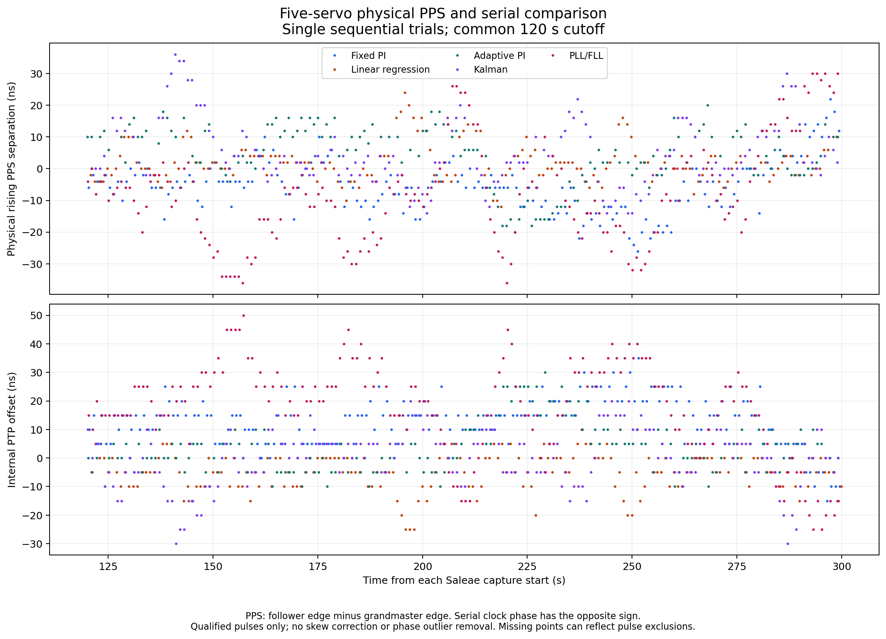
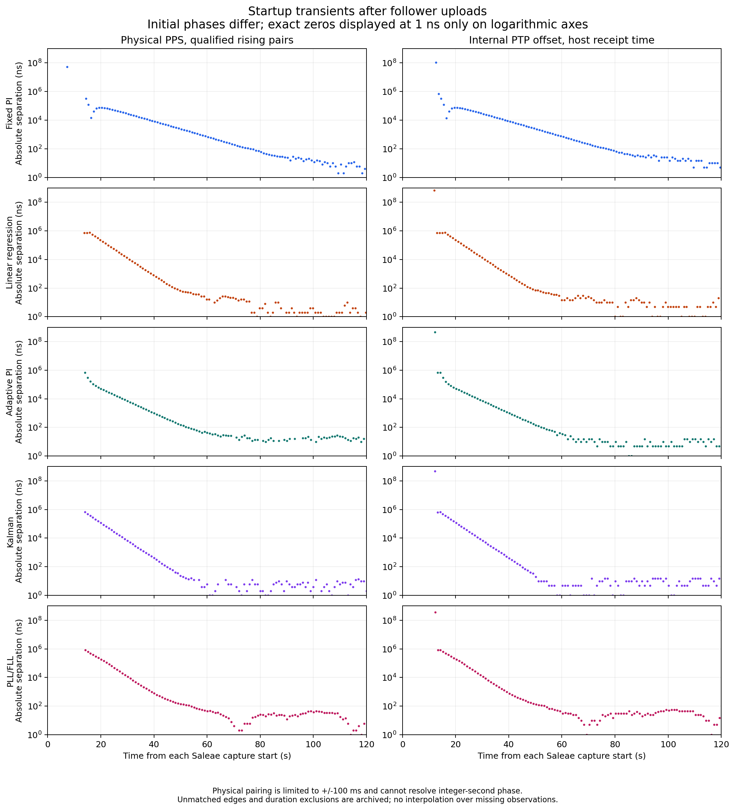
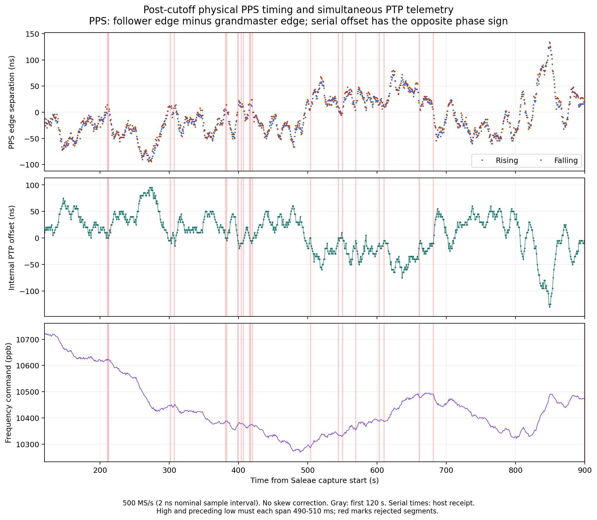

# Physical PPS comparison of five R4 servos

Completed October 16, 2026, 16:12:50 to 16:54:28 UTC. All six native captures
passed integrity and configuration checks. The raw follower logs contain
**2,334 accepted exchanges**, with no sample-number gaps or reported exchange
errors. Every post-cutoff serial sample is in s3 (180 per short trial and 780
in the longer PI run). The final firmware is grandmaster plus fixed-PI follower.

This campaign repeats the five-servo startup and steady-state experiments,
plus the longer fixed-PI run, with simultaneous Saleae PPS measurements and
serial telemetry. It uses the existing UNO R4 Minima pair, MAX3421E shields,
AX88279 TimeSticks, and direct Ethernet connection. It does not repeat the R3
or Linux-peer topology experiments.

## Measurement design

The sequence is fixed PI, linear regression, adaptive PI, Kalman, and PLL/FLL,
each with a 300-second capture after follower upload, followed by a 900-second
PI capture. The grandmaster is uploaded once at the beginning and given
30 seconds of lead time. Follower uploads can drop the link and cause the
grandmaster to reinitialize, so this is not an uninterrupted reference across
upload boundaries. Each condition has one sequential observation; order is
not randomized and initial phase offsets are not controlled.

All six firmware hashes match the original R4 campaign. The firmware and
controller parameters are unchanged. The five-second native-USB startup wait
allows the recorder to preserve each new follower boot log after upload. Each
capture retains both serial streams, host receipt timestamps, native Saleae
data, unfiltered CSV and binary exports, and SHA-256 hashes.

| Setting | Value |
| --- | --- |
| Instrument | Saleae Logic Pro 8, `DE6166D1E5FB7317` |
| Software | Logic 2.4.48; automation 1.0.11 |
| Digital sampling | 500 MS/s, no glitch filter |
| Logic preset | 3.3+ V, nominal switching threshold about 1.65 V |
| CH0 | Follower TimeStick, `9c69d3.fffe.2ba18d` |
| CH1 | Grandmaster TimeStick, `9c69d3.fffe.2ba12f` |
| Serial 0 / serial 1 | Grandmaster / follower, 115200 baud |
| PPS gate | 500 ms high |
| Acquisition exclusion | First 120 seconds from each Saleae capture start |
| Qualification | Complete high and preceding low must each span 490 to 510 ms |
| Pairing | Unique qualified corresponding edges within +/-100 ms |
| Physical sign | Follower edge arrival minus grandmaster edge arrival |
| Corrections | No skew, cable-delay, or timebase correction |

The qualification rule was carried forward from the earlier Saleae checks and
recorded in [the plan](plan.json) before analysis of this campaign's outcomes.
It is independent of inter-channel phase. All excluded edges and rejected
segments remain in the raw data and each derived summary. Physical PPS alone
cannot identify integer-second clock offsets. Startup pairs outside the
100 ms window are explicitly unmatched, not assigned a guessed cycle number.

The 120-second cutoff uses **Saleae capture start**, unlike the earlier
serial-only R4 analysis, which counted from the first accepted exchange.
Serial plots use host receipt times for approximate alignment. Samples are not
paired with individual physical PPS edges. Positive clock-phase offset gives
an earlier edge, so the serial and physical signs are opposite.

Raw serial files can include samples received just outside the native capture
interval. Serial plots and statistics retain receipt times within that
interval, then apply the common cutoff. Consequently, raw-log sample counts
can differ slightly from the plotted counts; each summary reports both the
retained and outside-interval counts.

The operator previously confirmed common signal ground and leads of the same
type and approximately the same length. The
[earlier same-source check](../saleae-pps/README.md#same-source-measurement-path-check)
is retained as a fixture observation; it is not a concurrent calibration and
is not subtracted from these results. No wiring changes were requested during
this campaign. A 2 ns nominal sampling interval is not 2 ns calibrated accuracy.

## Results and startup behavior

All timing values in the table are nanoseconds, after the 120-second cutoff.
Physical values use qualified rising-edge pairs.

| Condition | PPS pairs | PPS mean | PPS SD | PPS RMS | PPS min / max | Internal RMS |
| --- | ---: | ---: | ---: | ---: | ---: | ---: |
| Fixed PI | 177 | -5.58 | 8.23 | 9.94 | -26 / +22 | 15.70 |
| Linear regression | 170 | +1.87 | 5.93 | 6.22 | -12 / +24 | 8.04 |
| Adaptive PI | 155 | +4.36 | 9.18 | 10.16 | -20 / +20 | 9.28 |
| Kalman | 159 | +4.96 | 10.43 | 11.55 | -14 / +36 | 9.80 |
| PLL/FLL | 176 | -7.98 | 15.87 | 17.77 | -36 / +30 | 23.81 |
| Fixed PI, longer run | 758 | -8.31 | 37.53 | 38.44 | -92 / +134 | 38.16 |

[Derived statistics, pulse counts, and startup observations](plots/tables.md)
include both physical PPS and internal serial measurements. RMS is about zero;
standard deviation is the population statistic. No phase outliers are removed,
and no detrending or smoothing is applied.





Individual captures and plots:

| Condition | Full trace | Post-cutoff view | Raw recording and logs |
| --- | --- | --- | --- |
| Fixed PI | [Full](plots/pi/pps-and-serial.png) | [Steady](plots/pi/pps-steady-and-serial.png) | [PI](trials/pi/) |
| Linear regression | [Full](plots/linreg/pps-and-serial.png) | [Steady](plots/linreg/pps-steady-and-serial.png) | [Regression](trials/linreg/) |
| Adaptive PI | [Full](plots/adaptive-pi/pps-and-serial.png) | [Steady](plots/adaptive-pi/pps-steady-and-serial.png) | [Adaptive PI](trials/adaptive-pi/) |
| Kalman | [Full](plots/kalman/pps-and-serial.png) | [Steady](plots/kalman/pps-steady-and-serial.png) | [Kalman](trials/kalman/) |
| PLL/FLL | [Full](plots/pllfll/pps-and-serial.png) | [Steady](plots/pllfll/pps-steady-and-serial.png) | [PLL/FLL](trials/pllfll/) |
| PI, 900 seconds | [Full](plots/pi-steady/pps-and-serial.png) | [Steady](plots/pi-steady/pps-steady-and-serial.png) | [Longer PI](trials/pi-steady/) |

The startup figure uses absolute values and displays exact zeros at 1 ns solely
for logarithmic plotting. It includes observed upload/startup behavior, not
identical injected phase or frequency steps. Early PPS can reflect the retained
peripheral clock before initialization and before the first accepted exchange.
The raw record preserves those observations.

The physical settling diagnostic searches for a final in-band suffix lasting
at least 30 seconds, with no observation gap greater than 1.5 seconds and with
observations extending to within 1.5 seconds of capture end. Rejected pulses
can prevent that condition even if the controller remains locked. A result of
"not demonstrated" is not a claim that the servo failed to converge. Serial
first-s3 times and physical suffix times use different origins, stated in the
table, and should not be subtracted from one another.

## Longer PI record

The 900.091-second capture retained **758 qualified rising pairs**
after the cutoff, with **38.44 ns RMS**, mean **-8.31 ns**,
population standard deviation **37.53 ns**, and range
**-92 to +134 ns**. The simultaneous 780 internal samples
have **38.16 ns RMS**. The frequency command and offsets vary over
the window, so it does not establish stationary noise or thermal equilibrium.



The post-cutoff CH1 record contains 22 short high segments below one
microsecond. The full qualification report retains their timestamps and all
excluded cycles. This observation is separate from both the short PI trial
and the earlier 26.18 ns RMS PI capture; they are not pooled.

## Signal quality and interpretation

The preceding captures revealed brief extra transitions, including notches
near rising edges. This campaign retains the same measurement configuration
and reports exclusions alongside timing statistics. Startup changes and
boundary partial pulses can also fail qualification; rejected-segment counts
must not all be labeled hardware glitches. The quality table separately counts
post-cutoff short high segments below one microsecond.

Exclusions can be condition-dependent and can bias between-trial comparisons.
The RMS values characterize qualified observations, not an uninterrupted,
validated PPS stream. Differences between these sequential trials do not prove
general servo superiority. The instrument observes digital threshold crossings,
not analog edge shape. A clean repeat and signal-path investigation remain
necessary before a calibrated accuracy claim.

The grandmaster is free-running, without a UTC reference. Temperature, analog
levels, propagation delays, and instrument calibration were not measured. The
campaign ran later in the same powered session as the earlier PI observation;
neither equal thermal conditions nor equilibrium was established. Its values
should not be combined with the earlier trial as if conditions were identical.

## Archive and reproduction

- [Plan](plan.json): sequence, durations, firmware hashes, measurement rules,
  and limits recorded before outcome analysis.
- [Campaign manifest](trials/manifest.json): identities, verified firmware
  hashes, uploads, capture completion, serial counts, and checksums.
- Each `trials/<condition>/` folder contains `pps.sal`, `digital.csv`, both
  binary exports, both serial logs, receipt timestamps, and its own manifest.
- Each `plots/<condition>/` folder contains full and post-cutoff plots, edge
  detail, extracted observations, statistics, and every pulse exclusion.
- Extra-transition figures show at most the first six short-segment clusters;
  every raw transition and exclusion remains available in the data files.
- [SHA-256 inventory](SHA256SUMS): archive files, including plots and acquisition sources.
- [Combined summary](plots/summary.json) and [tables](plots/tables.md).
- [Acquisition sources](acquisition/): exact scripts copied from the instrument
  host. Only the upload, port-discovery, startup-capture, and timestamp helpers
  are imported from `run_r4_trials.py`; its original campaign entry point is
  not used. The older warm-up comment there does not establish equal phases.

From the repository root:

```sh
python3 tools/plot_saleae_trials.py docs/results/2026-10-16/saleae-servos/trials \
  --output-dir docs/results/2026-10-16/saleae-servos/plots
python3 -m unittest discover -s tests -p 'test_*.py'
```

Matplotlib is required for plotting. Analysis verifies real-device identity,
native sampling configuration, raw-file hashes, CSV/binary edge agreement,
follower boot and servo identity, and derived statistics. The optional
`--allow-incomplete` flag is for provisional analysis during acquisition only.

To repeat the measurements, use
[`run_saleae_trials.py`](../../../../tools/run_saleae_trials.py) on the instrument
host with Logic automation enabled, verified firmware images, the prior
firmware manifest, and the two Arduino USB serial identities. Use a fresh
output directory. The final scheduled condition restores fixed PI. No claim
of a completed run should be made if its campaign or capture manifest fails.

The acquisition command on the instrument host was equivalent to the following
(the output directory must not exist; paths and USB identities are specific
to this fixture):

```sh
~/tinyptp-r4/venv/bin/python ~/tinyptp-r4/tools/run_saleae_trials.py \
  --master-serial 320D1D22393131396E3833354B57336E \
  --follower-serial 320D072639313139112733354B57336E \
  --dfu-util ~/Library/Arduino15/packages/arduino/tools/dfu-util/0.11.0-arduino5/dfu-util \
  --firmware-dir ~/tinyptp-r4/firmware \
  --expected-manifest ~/tinyptp-r4/trials-04/manifest.json \
  --output-dir ~/tinyptp-r4/saleae/servo-campaign-02 \
  --device-id DE6166D1E5FB7317
```

The recorded run used `servo-campaign-01`; `servo-campaign-02` above avoids
reusing its archive. The runner requires `pyserial` and `logic2-automation`,
the matching `run_r4_trials.py` and `capture_pps_saleae.py` beside it, and
Logic's automation server on port 10430. It changes installed firmware and
captures the six conditions automatically. Verify the channel mapping before
repeating; the runner records the established mapping and cannot detect
swapped physical leads.
