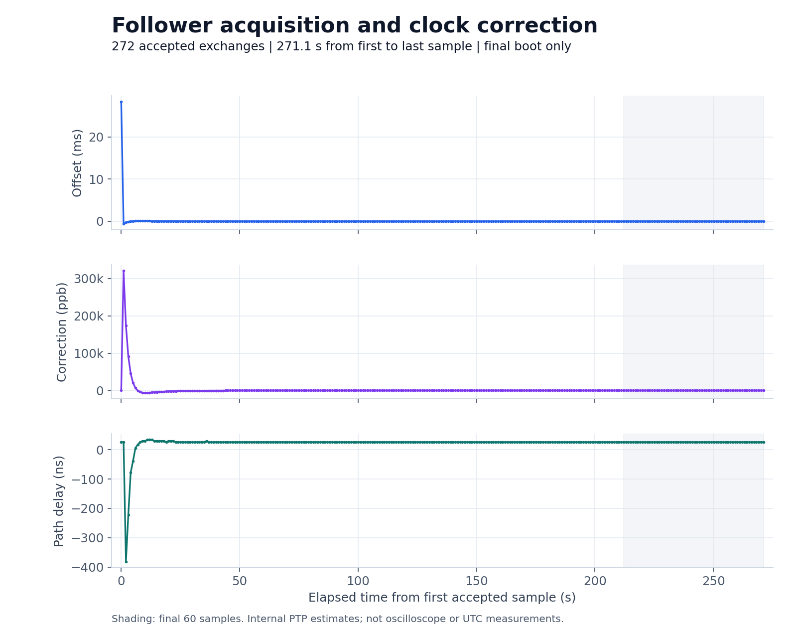
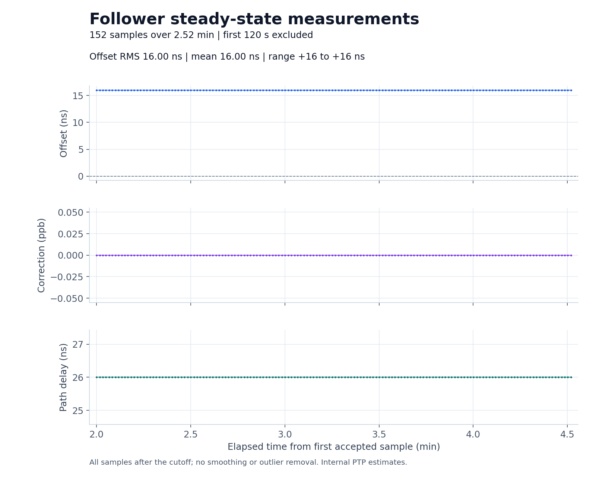

# AX88279A pair validation, 2026-10-30

Fixture: two classic Arduino UNO R3s, each with a MAX3421E USB Host Shield;
a user-identified TimeStick V3 and an AX88279A development board connected
by a direct Ethernet cable. Both enumerate as chip code 15, revision 1,
firmware 1.2.9.0. The [setup guide](../../../ax88279a.md) records the UNO
serials, MAC addresses, installation steps, and protocol limits.

## Captures

- `timestamp-format-probe.log`: the intentionally unsuccessful initial parser
  build. It expected 1,024 bytes and a set `tx_ts` bit. Actual EP4 replies were
  16-byte records with valid status `0x40`. This evidence informed the fix.
- `diagnostic/master.log` and `diagnostic/follower.log`: 150-second paired-reset
  capture after the fix, with diagnostic printing enabled. The follower accepted
  120 samples, performed one initial coarse step, and rejected two path estimates
  during acquisition. No exchange timeouts occurred. The final 60 estimates had
  RMS 20.40 ns, mean -18.93 ns, and range -48 to -16 ns. First `s3` was at
  follower uptime 70.389 s. Each board recovered from an initial link-down event.
- `steady-300s/`: the subsequent five-minute paired-reset validation using the
  same firmware, with normal serial output and no serial startup commands.
- `build-*.log` and `validation.txt`: compiler resource reports, test coverage,
  and the installed firmware hashes. The dedicated examples produce the same
  HEX images as the diagnostic run's explicitly selected variant builds.

Grandmaster uses 29,228 bytes of flash, follower 29,224 bytes; each reserves
878 bytes of static SRAM, leaving 1,170 bytes for stack/heap. Runtime stack
high-water use was not measured. All builds use AVR Boards 1.8.8 and USB Host
Shield Library 2.0 version 1.7.0.

PPS readbacks on both devices report output gate `0x4000`, clock control
`0x2702f`, and 500,000,000 ns active width. This is configuration evidence only.
The offset and delay statistics are internal PTP estimates, not independent
PPS edge measurements or UTC accuracy. Vendor 1 Gb/s pipeline compensation
was used without measuring this fixture's asymmetry.

Startup recovery is visible in the logs and is not omitted from the archive.
This is a short functional validation of one pair, not long-term reliability
or a comparison against the earlier AX88279/Saleae experiments.

## Five-minute result

The quiet capture started at 2026-10-30 22:46:18 UTC. Both roles started without
serial commands and recovered from one initial link-down event. The first
complete exchange was at follower uptime 27.122 s; the final sample was at
298.242 s. Grandmaster counters finished at 272 Sync/Follow_Up pairs and 272
Delay_Resp messages, matching the follower's **272 accepted samples**.

There were no exchange timeouts, rejected paths, missing RX timestamps,
discarded packets, or USB errors during this capture. The follower made one
initial coarse step and first reached `s3` at uptime 79.140 s.

| Fixed post-acquisition window | Result |
| --- | --- |
| Selection | Every sample at least 120 s after the first accepted sample |
| Samples | 152, all `s3` |
| Span | 151.070 s |
| Reported offset mean / RMS | +16 ns / 16 ns |
| Reported offset range | +16 to +16 ns |
| Reported path delay | 26 ns |
| Frequency correction | 0 ppb |
| Largest sample interval | 1.002 s |

These constant, quantized estimates do not establish zero physical jitter or
16 ns PPS accuracy. No samples were smoothed or removed from the steady window.





Both serial ports were released after the capture. The automatic firmware
remains installed and running, with no host PTP process required.

## Reproduce

From the repository root:

```sh
python3 tools/summarize_ptp.py \
  docs/results/2026-10-30/ax88279a/diagnostic/follower.log --tail 60
python3 tools/summarize_ptp.py \
  docs/results/2026-10-30/ax88279a/steady-300s/follower.log --tail 60
python3 tools/plot_follower.py \
  docs/results/2026-10-30/ax88279a/steady-300s/follower.log \
  --output-dir docs/results/2026-10-30/ax88279a/plots --tail 60
python3 tools/plot_steady_state.py \
  docs/results/2026-10-30/ax88279a/steady-300s/follower.log \
  --output-dir docs/results/2026-10-30/ax88279a/steady-plots --after 120
```

The steady window includes every accepted sample at least 120 seconds after
the first sample, with no state filtering, smoothing, or outlier removal.
Raw serial captures retain their CRLF line endings. `SHA256SUMS` covers the
captured evidence and analysis artifacts.
